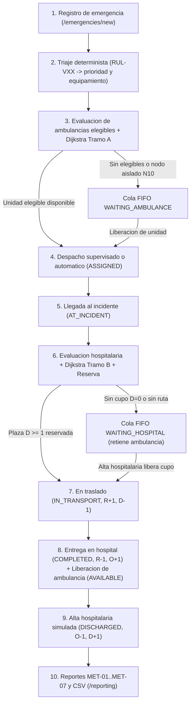
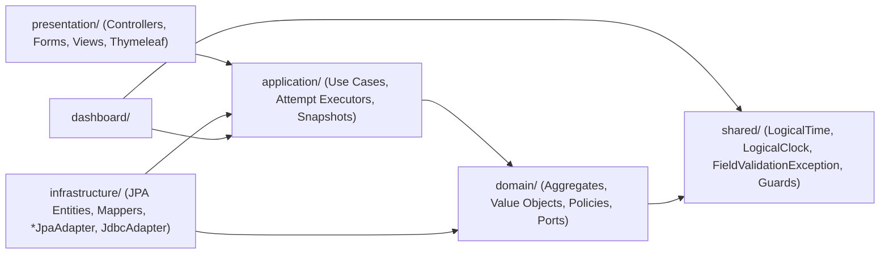
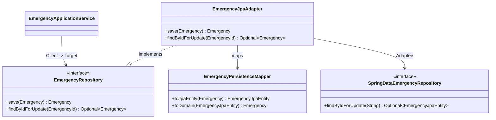
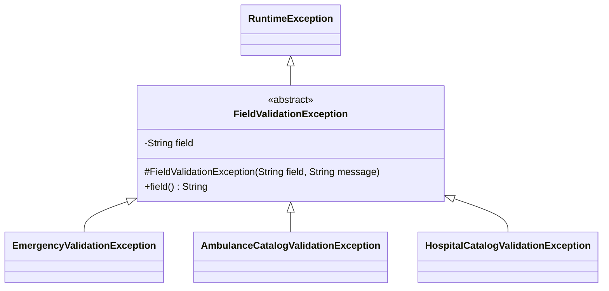
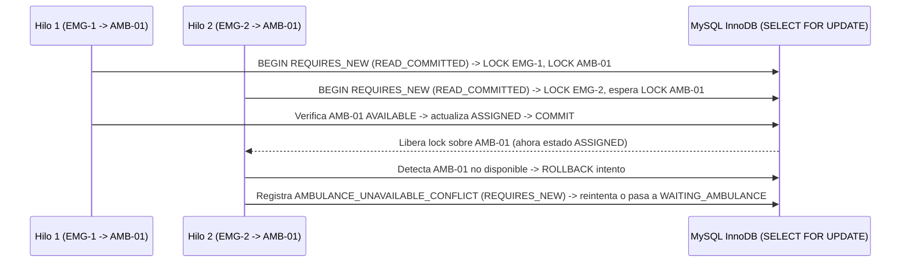
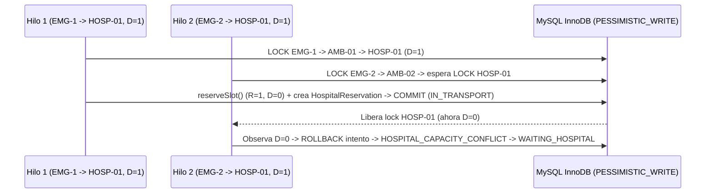

# ARE — Arequipa RescUE

[](pom.xml)
[](pom.xml)
[](compose.yaml)
[](src/main/resources/db/migration)
[](#10-calidad-del-software)
[](#)

Simulador académico de atención de emergencias médicas, despacho concurrente de ambulancias, cálculo de rutas mínimas mediante Dijkstra sobre una red vial simplificada de Arequipa (`N01`–`N10`) y gestión simulada de capacidad hospitalaria (`C = R + O + D`), construido en **Java 21** y **Spring Boot 3.4.5** bajo un **monolito modular con principios de arquitectura hexagonal** y **Spring MVC + Thymeleaf**.

> **Advertencia académica (`DEC-001`):** ARE es exclusivamente un simulador académico de ingeniería de software. No está validado ni debe utilizarse para despachar ambulancias reales ni para tomar decisiones clínicas.

---

## Tabla de contenidos

1. [Presentación y propósito](#1-presentación-y-propósito)
2. [Funcionamiento del sistema](#2-funcionamiento-del-sistema)
3. [Arquitectura de software](#3-arquitectura-de-software)
4. [Patrones de diseño](#4-patrones-de-diseño)
5. [Programación orientada a objetos avanzada](#5-programación-orientada-a-objetos-avanzada)
6. [Programación genérica](#6-programación-genérica)
7. [Principios SOLID](#7-principios-solid)
8. [Concurrencia y programación multihilo](#8-concurrencia-y-programación-multihilo)
9. [Algoritmos y estructuras de datos](#9-algoritmos-y-estructuras-de-datos)
10. [Calidad del software](#10-calidad-del-software)
11. [Metodología de construcción asistida por IA](#11-metodología-de-construcción-asistida-por-ia)
12. [Tecnologías utilizadas](#12-tecnologías-utilizadas)
13. [Instalación y ejecución](#13-instalación-y-ejecución)
14. [Escalabilidad y limitaciones](#14-escalabilidad-y-limitaciones)
15. [Matriz de trazabilidad académica](#15-matriz-de-trazabilidad-académica)

---

## 1. Presentación y propósito

- **Problema que aborda:** coordinar solicitudes simultáneas de emergencia con recursos escasos (ambulancias básicas/especializadas y plazas hospitalarias limitadas) preservando consistencia transaccional, trazabilidad de rutas y métricas experimentales reproducibles.
- **Objetivo general:** demostrar de forma verificable principios de ingeniería de software, arquitectura hexagonal, POO avanzada, concurrencia pesimista en base de datos, algoritmos sobre grafos y simulación discreta determinista.
- **Funcionalidades principales:**
  - Dashboard operativo de inicio (`/`) con perfil activo, relojes diferenciados, KPIs reales, distribución por 7 estados y avisos condicionales.
  - Registro y clasificación determinista de emergencias mediante versiones inmutables de reglas de triaje (`RUL-V01`).
  - Despacho supervisado (`maxAttempts = 1`) y automático con reintentos acotados (`1 + 3`), colas FIFO (`WAITING_AMBULANCE`, `WAITING_HOSPITAL`) y visualización interactiva de rutas Dijkstra (Tramo A y Tramo B persistidos).
  - Gestión de capacidad hospitalaria `C = R + O + D`, reservas concurrentes (`1 + 2` reintentos), entrega hospitalaria, liberación de ambulancia y alta simulada.
  - Motor de simulación de eventos discretos (`/simulation`) con reloj lógico monotónico (`t >= 0`), restauración tras reinicio y comparación real Antes/Después.
  - Panel de reportes (`/reporting`) con las 7 métricas normativas (`MET-01`–`MET-07`), 4 gráficos Chart.js, 3 tarjetas complementarias, filtros de trazabilidad y exportación CSV segura (`/reporting/export.csv`).

---

## 2. Funcionamiento del sistema



### Comportamiento ante contingencias reales

- **Sin ambulancia elegible o sin ruta válida (por ejemplo, nodo aislado `N10`):** la emergencia transiciona a `WAITING_AMBULANCE` con `0` reintentos vacíos (`NO_ELIGIBLE_AMBULANCE`) y conserva su orden FIFO por `(queue_entered_at_t ASC, id ASC)`.
- **Agotamiento de reintentos por contención concurrente:** en despacho automático (4 intentos) persiste `CONCURRENCY_RETRY_EXHAUSTED` y pasa a `WAITING_AMBULANCE`; en reserva hospitalaria (3 intentos) persiste `HOSPITAL_RESERVATION_RETRY_EXHAUSTED` y pasa a `WAITING_HOSPITAL` reteniendo la ambulancia en `AT_INCIDENT`.
- **Sin capacidad hospitalaria (`D = 0`) o sin hospital alcanzable:** la emergencia ingresa o permanece en `WAITING_HOSPITAL` sin perder su posición FIFO (`CA-HOS-09`) hasta que un alta simulada libere una plaza (`O - 1, D + 1`).

---

## 3. Arquitectura de software

ARE combina cuatro conceptos complementarios sin confundirlos:

- **Monolito modular:** una única unidad desplegable Maven/Spring Boot dividida en **9 módulos** cohesivos con fronteras explícitas (`ADR-0001`).
- **Arquitectura hexagonal / Ports and Adapters:** el dominio (`domain/`) y los casos de uso (`application/`) permanecen aislados de Spring, JPA y HTTP; toda interacción técnica entra o sale mediante **puertos** (interfaces) implementados por **adaptadores** en `infrastructure/`.
- **MVC en presentación:** Spring MVC + Thymeleaf (`presentation/`) gestiona peticiones HTTP, DTOs de vista y plantillas sin ejecutar reglas de negocio.



### Estructura real de módulos (`src/main/java/com/arequiparescue/`, RC `930bf57`)

| Módulo | Capas internas | Responsabilidad principal | Enlace |
|---|---|---|---|
| `emergency` | `domain`, `application`, `infrastructure`, `presentation` | Registro, máquina de 7 estados, triaje determinista, versionado `RUL-VXX` y segmentos de ruta Dijkstra (`ADR-0003`) | [`emergency/`](src/main/java/com/arequiparescue/emergency) |
| `ambulance` | `domain`, `application`, `infrastructure`, `presentation` | Catálogo `BASIC`/`SPECIALIZED`, estados operativos y bloqueo en escenario activo | [`ambulance/`](src/main/java/com/arequiparescue/ambulance) |
| `hospital` | `domain`, `application`, `infrastructure`, `presentation` | Catálogo hospitalario, invariante `C = R + O + D`, reservas concurrentes, entrega y alta simulada | [`hospital/`](src/main/java/com/arequiparescue/hospital) |
| `dispatch` | `domain`, `application`, `infrastructure`, `presentation` | Elegibilidad, preservación, despacho supervisado/automático (`1+3`), colas y trazabilidad | [`dispatch/`](src/main/java/com/arequiparescue/dispatch) |
| `routing` | `domain`, `infrastructure`, `presentation` | Grafo `N01`–`N10`, algoritmo de Dijkstra y topología interactiva | [`routing/`](src/main/java/com/arequiparescue/routing) |
| `simulation` | `domain`, `application`, `infrastructure`, `presentation` | Escenarios experimentales, motor de eventos discretos, `ActiveScenarioChecker` y panel comparativo | [`simulation/`](src/main/java/com/arequiparescue/simulation) |
| `reporting` | `domain`, `application`, `infrastructure`, `presentation` | `MET-01`–`MET-07`, indicadores complementarios, filtros y exportación CSV | [`reporting/`](src/main/java/com/arequiparescue/reporting) |
| `dashboard` | `application`, `presentation` | Centro de control operativo de inicio (`/`) desacoplado del núcleo `shared/` | [`dashboard/`](src/main/java/com/arequiparescue/dashboard) |
| `shared` | `domain`, `infrastructure`, `presentation` | Núcleo transversal puro (`0` imports hacia módulos funcionales): `LogicalTime`, `LogicalClock`, `FieldValidationException`, guardias de BD y `AreUiFormatter` | [`shared/`](src/main/java/com/arequiparescue/shared) |

### ¿Por qué se separan las entidades del dominio de las entidades JPA?

Las entidades JPA (`*JpaEntity`) requieren constructores sin argumentos, atributos mutables y anotaciones de Hibernate (`@Entity`, `@Table`, `@Column`). Separarlas del dominio (`Emergency`, `Ambulance`, `Hospital`, `HospitalReservation`) garantiza que:
1. El dominio se prueba en milisegundos sin iniciar Spring ni conectarse a MySQL.
2. Ninguna entidad gestionada por Hibernate llega a Thymeleaf (`spring.jpa.open-in-view=false`).
3. Toda reconstrucción desde base de datos revalida las invariantes de negocio mediante mappers explícitos.

Documentación arquitectónica relacionada: [`AGENTS.md`](AGENTS.md), [`ADR-0001`](docs/decisions/adr/ADR-0001-arquitectura-modular-persistencia-stack-y-pruebas.md), [`ADR-0002`](docs/decisions/adr/ADR-0002-concurrencia-bloqueo-pesimista-transacciones-y-reintentos.md), [`ADR-0003`](docs/decisions/adr/ADR-0003-persistencia-historica-de-rutas-dijkstra.md), [`decision-log.md`](docs/decisions/decision-log.md), [`docs/architecture/c4/README.md`](docs/architecture/c4/README.md) y [`docs/development/module-guide.md`](docs/development/module-guide.md).

---

## 4. Patrones de diseño

> **Rigor de clasificación:** en ARE **no** se clasifican como patrones GoF ni a MVC ni a Repository, **no** se presentan los métodos estáticos `register`/`reconstruct` como GoF Factory Method, **no** se presenta el `enum EmergencyState` como GoF State, **no** se presentan interfaces individuales como GoF Strategy ni los beans `@Service` de Spring como implementación propia de GoF Singleton.

### 4.1. Adapter (GoF — Estructural)

1. **Definición:** convierte la interfaz de una clase o dependencia existente (*Adaptee*) en otra interfaz esperada por los clientes (*Target*).
2. **Clasificación:** patrón estructural GoF (implementado explícitamente por el equipo en 11 adaptadores).
3. **Problema que resuelve en ARE:** desacoplar los servicios de aplicación y dominio de las interfaces incompatibles de Spring Data JPA (`EmergencyJpaEntity`, `String`) y `JdbcTemplate` (`ResultSet`).
4. **Cómo está implementado:** cada adaptador implementa un puerto de dominio (`domain/port/`) y delega en repositorios Spring Data o `JdbcTemplate`, traduciendo tipos mediante mappers explícitos.
5. **Participantes:**
   - *Client:* [`EmergencyApplicationService`](src/main/java/com/arequiparescue/emergency/application/EmergencyApplicationService.java) / [`ReportingApplicationService`](src/main/java/com/arequiparescue/reporting/application/ReportingApplicationService.java)
   - *Target:* [`EmergencyRepository`](src/main/java/com/arequiparescue/emergency/domain/port/EmergencyRepository.java) / [`ReportingDataQueryPort`](src/main/java/com/arequiparescue/reporting/domain/port/ReportingDataQueryPort.java)
   - *Adapter:* [`EmergencyJpaAdapter`](src/main/java/com/arequiparescue/emergency/infrastructure/persistence/EmergencyJpaAdapter.java) / [`ReportingDataJdbcAdapter`](src/main/java/com/arequiparescue/reporting/infrastructure/persistence/ReportingDataJdbcAdapter.java)
   - *Adaptee:* [`SpringDataEmergencyRepository`](src/main/java/com/arequiparescue/emergency/infrastructure/persistence/SpringDataEmergencyRepository.java) / `JdbcTemplate`

```java
// src/main/java/com/arequiparescue/emergency/infrastructure/persistence/EmergencyJpaAdapter.java (L35-L59)
@Override
@Transactional
public Emergency save(Emergency emergency) {
    Objects.requireNonNull(emergency, "La emergencia a persistir no puede ser nula.");
    EmergencyJpaEntity entity = EmergencyPersistenceMapper.toJpaEntity(emergency);
    EmergencyJpaEntity saved = springDataEmergencyRepository.saveAndFlush(entity);
    return EmergencyPersistenceMapper.toDomain(saved);
}

@Override
public Optional<Emergency> findByIdForUpdate(EmergencyId id) {
    Objects.requireNonNull(id, "El identificador de la emergencia a bloquear no puede ser nulo.");
    return springDataEmergencyRepository
            .findByIdForUpdate(id.value())
            .map(EmergencyPersistenceMapper::toDomain);
}
```

- **Explicación del fragmento:** `EmergencyJpaAdapter` traduce el objeto de valor `EmergencyId` a `String`, invoca la consulta bloqueante de Spring Data y reconstruye el agregado `Emergency` validando invariantes. De forma análoga, `ReportingDataJdbcAdapter` implementa `ReportingDataQueryPort` usando `JdbcTemplate` plano sin JPA.
- **Beneficios:** permite sustituir JPA por JDBC o por mocks en pruebas unitarias sin tocar el dominio ni los casos de uso.
- **Enlaces:** [`EmergencyRepository.java`](src/main/java/com/arequiparescue/emergency/domain/port/EmergencyRepository.java) · [`EmergencyJpaAdapter.java`](https://github.com/giovani202320/ProyectoFinalTO-Arequipa-RescUE/blob/930bf57eb79708de54be7b267700764b4ef79944/src/main/java/com/arequiparescue/emergency/infrastructure/persistence/EmergencyJpaAdapter.java#L20-L59) · [`SpringDataEmergencyRepository.java`](src/main/java/com/arequiparescue/emergency/infrastructure/persistence/SpringDataEmergencyRepository.java) · [`ReportingDataQueryPort.java`](src/main/java/com/arequiparescue/reporting/domain/port/ReportingDataQueryPort.java) · [`ReportingDataJdbcAdapter.java`](src/main/java/com/arequiparescue/reporting/infrastructure/persistence/ReportingDataJdbcAdapter.java)
- **Pruebas:** [`EmergencyMySqlIntegrationTest.java`](src/test/java/com/arequiparescue/EmergencyMySqlIntegrationTest.java) · [`ReportingMySqlIntegrationTest.java`](src/test/java/com/arequiparescue/ReportingMySqlIntegrationTest.java)



### 4.2. Repository (Arquitectónico / Empresarial — PoEAA / DDD)

1. **Definición:** media entre el dominio y las capas de mapeo de datos exponiendo una interfaz semejante a una colección de agregados.
2. **Clasificación:** patrón arquitectónico/empresarial (NO patrón GoF).
3. **Problema que resuelve en ARE:** ofrecer consultas con semántica de negocio (`findWaitingAmbulanceOrderByQueueEnteredAtAndId`, `findByIdForUpdate`) ocultando SQL, índices y bloqueos.
4. **Diferencia clave en ARE:** los **repositorios de dominio** (`EmergencyRepository`, `AmbulanceRepository`, `HospitalRepository` en `domain/port/`) son interfaces 100 % Java puro; los **repositorios de Spring Data JPA** (`SpringDataEmergencyRepository extends JpaRepository<EmergencyJpaEntity, String>` en `infrastructure/persistence/`) son detalles técnicos encapsulados dentro de cada `*JpaAdapter`.
5. **Participantes:** `EmergencyRepository`, `EmergencyJpaAdapter`, `SpringDataEmergencyRepository`, `EmergencyApplicationService`.
6. **Fragmento real:**

```java
// src/main/java/com/arequiparescue/emergency/domain/port/EmergencyRepository.java
Optional<Emergency> findByIdForUpdate(EmergencyId id);
List<Emergency> findWaitingAmbulanceOrderByQueueEnteredAtAndId();
List<Emergency> findWaitingHospitalOrderByHospitalQueueEnteredAtAndId();
```

7. **Explicación:** las firmas expresan intención del dominio (ordenamiento FIFO de colas y bloqueo pesimista) usando tipos de dominio (`Emergency`, `EmergencyId`).
8. **Beneficios:** evita fugas de JPQL o entidades JPA en los casos de uso y habilita pruebas unitarias rápidas con dobles de prueba.
9. **Enlaces:** [`EmergencyRepository.java`](src/main/java/com/arequiparescue/emergency/domain/port/EmergencyRepository.java) · [`AmbulanceRepository.java`](src/main/java/com/arequiparescue/ambulance/domain/port/AmbulanceRepository.java) · [`HospitalRepository.java`](src/main/java/com/arequiparescue/hospital/domain/port/HospitalRepository.java)
10. **Prueba relacionada:** [`EmergencyApplicationServiceTest.java`](src/test/java/com/arequiparescue/emergency/application/EmergencyApplicationServiceTest.java)

### 4.3. Data Mapper (Arquitectónico / Empresarial — PoEAA)

1. **Definición:** capa dedicada que transfiere datos bidireccionalmente entre objetos de dominio en memoria y modelos de persistencia relacional manteniéndolos independientes.
2. **Clasificación:** patrón arquitectónico/empresarial (implementado explícitamente por el equipo).
3. **Problema que resuelve en ARE:** impedir que `Emergency` dependa de `@Entity` o que Hibernate omita la validación de invariantes al hidratar filas de MySQL.
4. **Cómo está implementado:** clases utilitarias finales en `infrastructure/persistence/` (`EmergencyPersistenceMapper`, `AmbulancePersistenceMapper`, `HospitalPersistenceMapper`, etc.) con métodos `toJpaEntity(...)` y `toDomain(...)`.
5. **Participantes:** `Emergency`, `EmergencyJpaEntity`, `EmergencyPersistenceMapper`, `EmergencyJpaAdapter`.

<details>
<summary>Ver fragmento real de <code>EmergencyPersistenceMapper.java</code> (líneas 24–70)</summary>

```java
// src/main/java/com/arequiparescue/emergency/infrastructure/persistence/EmergencyPersistenceMapper.java (L24-L70)
public static EmergencyJpaEntity toJpaEntity(Emergency emergency) {
    Objects.requireNonNull(emergency, "La entidad de dominio Emergency a mapear no puede ser nula.");
    return new EmergencyJpaEntity(
            emergency.id().value(), emergency.category().code(), emergency.locationNode().value(),
            emergency.description(), emergency.simulatedPriority().name(), emergency.requiredEquipment().name(),
            emergency.appliedRuleVersionId().value(), emergency.state().name(),
            emergency.assignedAmbulanceId(), emergency.reservedOrOccupiedHospitalId(),
            emergency.registeredAt().ticks(), toNullableTicks(emergency.queueEnteredAt()),
            toNullableTicks(emergency.assignedAt()), toNullableTicks(emergency.atIncidentAt()),
            toNullableTicks(emergency.hospitalQueueEnteredAt()), toNullableTicks(emergency.inTransportAt()),
            toNullableTicks(emergency.completedAt()), emergency.lastOutcomeReason()
    );
}

public static Emergency toDomain(EmergencyJpaEntity entity) {
    Objects.requireNonNull(entity, "La entidad JPA EmergencyJpaEntity a mapear no puede ser nula.");
    return Emergency.reconstruct(
            EmergencyId.of(entity.getId()), IncidentCategory.fromCode(entity.getIncidentCategory()),
            NodeId.of(entity.getNodeId()), entity.getDescription(),
            SimulatedPriority.valueOf(entity.getSimulatedPriority()), EquipmentType.valueOf(entity.getRequiredEquipment()),
            TriageRuleVersionId.of(entity.getRuleVersionId()), EmergencyState.valueOf(entity.getState()),
            entity.getAssignedAmbulanceId(), entity.getHospitalId(),
            LogicalTime.of(entity.getRegisteredAtTicks()), toNullableLogicalTime(entity.getQueueEnteredAtTicks()),
            toNullableLogicalTime(entity.getAssignedAtTicks()), toNullableLogicalTime(entity.getAtIncidentAtTicks()),
            toNullableLogicalTime(entity.getHospitalQueueEnteredAtTicks()), toNullableLogicalTime(entity.getInTransportAtTicks()),
            toNullableLogicalTime(entity.getCompletedAtTicks()), entity.getLastOutcomeReason()
    );
}
```

</details>

- **Explicación y beneficios:** `toDomain` invoca `Emergency.reconstruct(...)`, asegurando que ninguna fila corrupta pase silenciosamente al dominio; `toJpaEntity` aplana Value Objects (`EmergencyId`, `NodeId`, `LogicalTime`) a primitivos SQL.
- **Enlaces:** [`EmergencyPersistenceMapper.java`](https://github.com/giovani202320/ProyectoFinalTO-Arequipa-RescUE/blob/930bf57eb79708de54be7b267700764b4ef79944/src/main/java/com/arequiparescue/emergency/infrastructure/persistence/EmergencyPersistenceMapper.java#L19-L70) · [`EmergencyJpaEntity.java`](src/main/java/com/arequiparescue/emergency/infrastructure/persistence/EmergencyJpaEntity.java)
- **Prueba relacionada:** [`EmergencyMySqlIntegrationTest.java`](src/test/java/com/arequiparescue/EmergencyMySqlIntegrationTest.java)

### 4.4. Model-View-Controller — MVC (Arquitectónico de presentación)

1. **Definición:** separa la interacción HTTP (*Controller*), los datos preparados para pantalla (*Model / DTO*) y el renderizado HTML (*View*).
2. **Clasificación:** patrón arquitectónico de presentación (NO patrón GoF; implementado sobre Spring MVC y Thymeleaf).
3. **Problema que resuelve en ARE:** desacoplar formularios, redirecciones, códigos HTTP (`200`, `400`, `409`) y vistas HTML de la lógica de negocio.
4. **Cómo está implementado:** cada módulo expone controladores `@Controller` que invocan servicios de aplicación, adaptan snapshots/agregados a DTOs de presentación (`HomeStatusView`, `EmergencyView`) y devuelven plantillas Thymeleaf (`src/main/resources/templates/`).
5. **Participantes:** [`HomeController`](src/main/java/com/arequiparescue/dashboard/presentation/HomeController.java), [`HomeStatusView`](src/main/java/com/arequiparescue/dashboard/presentation/HomeStatusView.java), [`home.html`](src/main/resources/templates/home.html), [`ReportingController`](src/main/java/com/arequiparescue/reporting/presentation/ReportingController.java).

```java
// src/main/java/com/arequiparescue/dashboard/presentation/HomeController.java (L33-L38)
@GetMapping("/")
public String home(Model model) {
    HomeDashboardSnapshot snapshot = dashboardService.loadDashboardSnapshot();
    model.addAttribute("status", toView(snapshot));
    return "home";
}
```

- **Explicación y beneficios:** `HomeController` nunca accede a repositorios JPA; adapta el snapshot de aplicación `HomeDashboardSnapshot` al DTO de vista `HomeStatusView`, permitiendo probar la capa web de forma aislada con `@WebMvcTest`.
- **Enlaces:** [`HomeController.java`](https://github.com/giovani202320/ProyectoFinalTO-Arequipa-RescUE/blob/930bf57eb79708de54be7b267700764b4ef79944/src/main/java/com/arequiparescue/dashboard/presentation/HomeController.java#L17-L40) · [`ReportingController.java`](src/main/java/com/arequiparescue/reporting/presentation/ReportingController.java) · [`home.html`](src/main/resources/templates/home.html)
- **Pruebas:** [`HomeControllerTest.java`](src/test/java/com/arequiparescue/dashboard/presentation/HomeControllerTest.java) · [`ReportingControllerTest.java`](src/test/java/com/arequiparescue/reporting/presentation/ReportingControllerTest.java)

### 4.5. Value Object (Táctico de DDD / PoEAA)

1. **Definición:** objeto pequeño e inmutable cuya identidad está definida por su valor y que encapsula sus propias reglas de validación y comparación.
2. **Clasificación:** patrón táctico de diseño de dominio (implementado explícitamente en `record` y `final class`).
3. **Problema que resuelve en ARE:** eliminar *primitive obsession* (evitar confundir un `EmergencyId` con un `HospitalId` o un `NodeId`, y prohibir tiempos lógicos negativos).
4. **Participantes:** [`EmergencyId`](src/main/java/com/arequiparescue/emergency/domain/EmergencyId.java), [`AmbulanceId`](src/main/java/com/arequiparescue/ambulance/domain/AmbulanceId.java), [`HospitalId`](src/main/java/com/arequiparescue/hospital/domain/HospitalId.java), [`NodeId`](src/main/java/com/arequiparescue/routing/domain/NodeId.java), [`LogicalTime`](src/main/java/com/arequiparescue/shared/domain/LogicalTime.java).

```java
// src/main/java/com/arequiparescue/shared/domain/LogicalTime.java (L9-L26)
public final class LogicalTime implements Comparable<LogicalTime> {
    public static final LogicalTime ZERO = new LogicalTime(0L);
    private final long ticks;
    private LogicalTime(long ticks) {
        if (ticks < 0L) {
            throw new IllegalArgumentException("El tiempo lógico no puede ser negativo (t >= 0). Valor recibido: " + ticks);
        }
        this.ticks = ticks;
    }
    public static LogicalTime of(long ticks) { return ticks == 0L ? ZERO : new LogicalTime(ticks); }
}
```

- **Explicación y beneficios:** hace imposible construir en memoria un `LogicalTime` negativo y aporta comparación determinista vía `Comparable<LogicalTime>`.
- **Enlaces y pruebas:** [`LogicalTime.java`](src/main/java/com/arequiparescue/shared/domain/LogicalTime.java) · [`EmergencyId.java`](src/main/java/com/arequiparescue/emergency/domain/EmergencyId.java) · [`LogicalClockTest.java`](src/test/java/com/arequiparescue/shared/domain/LogicalClockTest.java)

---

## 5. Programación orientada a objetos avanzada

Inventario real en `src/main/java/` (`930bf57`): **188 archivos Java**, **1 clase abstracta**, **26 interfaces** (12 puertos propios + 14 Spring Data), **98 `record`**, **17 `enum`**.

### 5.1. Abstracción
- **Definición:** exponer contratos esenciales ocultando detalles de implementación.
- **Aplicación en ARE:** 12 puertos de dominio (`EmergencyRepository`, `ActiveScenarioChecker`, `ReportingDataQueryPort`, etc.) ocultan JPA/SQL, y la clase abstracta [`FieldValidationException`](src/main/java/com/arequiparescue/shared/domain/FieldValidationException.java) abstrae la noción común de error de validación asociado a un campo de formulario.
- **Prueba:** [`FieldValidationExceptionTest.java`](src/test/java/com/arequiparescue/shared/domain/FieldValidationExceptionTest.java)

### 5.2. Encapsulamiento
- **Definición:** restringir el acceso directo al estado interno y obligar a que toda mutación o transición respete invariantes.
- **Aplicación en ARE:** `Emergency`, `Ambulance` y `Hospital` son `public final class` con atributos `private final`, constructores privados y **cero setters públicos**.

```java
// src/main/java/com/arequiparescue/ambulance/domain/Ambulance.java (L87-L95)
private static void validateStateBindingInvariants(AmbulanceState state, EmergencyId assignedEmergencyId) {
    if (state == AmbulanceState.AVAILABLE && assignedEmergencyId != null) {
        throw new IllegalArgumentException(
                "Violación de INV-SM-02: una ambulancia en estado AVAILABLE no puede tener una emergencia activamente vinculada.");
    }
    if (state != AmbulanceState.AVAILABLE && assignedEmergencyId == null) {
        throw new IllegalArgumentException(
                "Violación de INV-SM-02: una ambulancia en estado " + state
                        + " requiere mantener asignado el identificador de su emergencia activa.");
    }
}
```

- **Enlaces y pruebas:** [`Emergency.java`](src/main/java/com/arequiparescue/emergency/domain/Emergency.java) · [`Ambulance.java`](https://github.com/giovani202320/ProyectoFinalTO-Arequipa-RescUE/blob/930bf57eb79708de54be7b267700764b4ef79944/src/main/java/com/arequiparescue/ambulance/domain/Ambulance.java#L14-L95) · [`Hospital.java`](src/main/java/com/arequiparescue/hospital/domain/Hospital.java) · [`AmbulanceDomainTest.java`](src/test/java/com/arequiparescue/ambulance/domain/AmbulanceDomainTest.java) · [`HospitalDomainTest.java`](src/test/java/com/arequiparescue/hospital/domain/HospitalDomainTest.java)

### 5.3. Herencia
- **Definición:** mecanismo de generalización/especialización donde una subclase hereda estado y comportamiento de una superclase respetando sustitución (*is-a*).
- **Aplicación en ARE:** jerarquía real y acotada en excepciones de validación de campo, evitando herencias artificiales (`BaseEntity`) en agregados del dominio donde se privilegia composición.



```java
// src/main/java/com/arequiparescue/shared/domain/FieldValidationException.java (L8-L19)
public abstract class FieldValidationException extends RuntimeException {
    private final String field;

    protected FieldValidationException(String field, String message) {
        super(message);
        this.field = field;
    }

    public String field() {
        return field;
    }
}

// src/main/java/com/arequiparescue/emergency/application/EmergencyValidationException.java (L8-L13)
public class EmergencyValidationException extends FieldValidationException {
    public EmergencyValidationException(String field, String message) {
        super(field, message);
    }
}
```

- **Por qué herencia aquí y composición en el dominio:** las 3 excepciones comparten semántica y estructura idéntica (`field` + `message` + comportamiento unchecked para rollback), mientras que `Emergency`, `Ambulance` y `Hospital` tienen ciclos de vida disjuntos sin relación *is-a*.
- **Enlaces y prueba:** [`FieldValidationException.java`](src/main/java/com/arequiparescue/shared/domain/FieldValidationException.java) · [`EmergencyValidationException.java`](src/main/java/com/arequiparescue/emergency/application/EmergencyValidationException.java) · [`AmbulanceCatalogValidationException.java`](src/main/java/com/arequiparescue/ambulance/application/AmbulanceCatalogValidationException.java) · [`HospitalCatalogValidationException.java`](src/main/java/com/arequiparescue/hospital/application/HospitalCatalogValidationException.java) · [`FieldValidationExceptionTest.java`](src/test/java/com/arequiparescue/shared/domain/FieldValidationExceptionTest.java)

### 5.4. Polimorfismo
- **Polimorfismo por interfaces y sustitución:** los servicios de aplicación operan contra puertos (`EmergencyRepository`, `ReportingDataQueryPort`, `ActiveScenarioChecker`), sustituidos en tiempo de ejecución por adaptadores JPA/JDBC y en pruebas unitarias por mocks.
- **Polimorfismo por herencia:** tratamiento uniforme de `EmergencyValidationException`, `AmbulanceCatalogValidationException` y `HospitalCatalogValidationException` mediante referencias `FieldValidationException` (verificado en [`FieldValidationExceptionTest.java`](src/test/java/com/arequiparescue/shared/domain/FieldValidationExceptionTest.java)).
- **Sobrescritura (`@Override`) y sobrecarga:** `@Override compareTo` en `DiscreteEvent` y `LogicalTime`; constructores sobrecargados en `LogicalClock()`, `LogicalClock(LogicalTime)`, `HospitalCatalogValidationException(String)` y `HospitalCatalogValidationException(String, String)`.

### 5.5. Composición
- **Aplicación en ARE:** `Emergency` compone Value Objects (`EmergencyId`, `NodeId`, `LogicalTime`); `DiscreteEventScheduler` compone `PriorityQueue<DiscreteEvent>` y agrega `LogicalClock`; [`HomeDashboardApplicationService`](src/main/java/com/arequiparescue/dashboard/application/HomeDashboardApplicationService.java) compone 4 servicios de aplicación existentes sin heredar de ninguno.

### 5.6. Inmutabilidad vs. estado mutable sincronizado
- **Objetos inmutables:** agregados (`Emergency`, `Ambulance`, `Hospital`, `HospitalReservation`, `SimulationScenario`), Value Objects (`LogicalTime`) y 98 `record` (`HomeDashboardSnapshot`, `ReportingSupplementaryMetrics.*`). Sus transiciones devuelven instancias nuevas (`hospital.reserveSlot()`).
- **Componente mutable sincronizado:** [`LogicalClock`](src/main/java/com/arequiparescue/shared/domain/LogicalClock.java) mantiene un único campo mutable `private LogicalTime currentTime` protegido con `synchronized` en todos sus accesos y avances monotónicos.

### 5.7. Manejo de excepciones
- **Validaciones de negocio:** `FieldValidationException` (y subclases) y `DispatchValidationException` devuelven mensajes claros en formularios (`HTTP 400`).
- **Invariantes del dominio:** `IllegalArgumentException` e `IllegalStateException`.
- **Conflictos concurrentes vs. errores técnicos (`ADR-0002`):** [`DispatchApplicationService.assignSupervised`](https://github.com/giovani202320/ProyectoFinalTO-Arequipa-RescUE/blob/930bf57eb79708de54be7b267700764b4ef79944/src/main/java/com/arequiparescue/dispatch/application/DispatchApplicationService.java#L107-L129) y `assignAutomatic` distinguen explícitamente `PessimisticLockingFailureException` (conflicto concurrente) de `DataIntegrityViolationException` u otros `RuntimeException` técnicos (registrados como `TECHNICAL_ERROR` y relanzados tras rollback en `REQUIRES_NEW`, sin contaminar `MET-06`).
- **Prueba:** [`AutomaticDispatchRetryTest.java`](src/test/java/com/arequiparescue/dispatch/application/AutomaticDispatchRetryTest.java)

---

## 6. Programación genérica

La programación genérica permite parametrizar tipos garantizando verificación estática en compilación (*type safety*) sin *casts* inseguros.

> **Transparencia académica:** en el commit `930bf57`, ARE **no define clases, interfaces ni métodos genéricos propios (`0` declaraciones genéricas propias)**. Toda parametrización proviene de la biblioteca estándar de Java (JDK) y de Spring Data JPA, elegida donde aporta seguridad de tipos real sin introducir abstracciones artificiales.

| Origen | Tipos genéricos reales usados en ARE | Dónde se aplican |
|---|---|---|
| **JDK** | `PriorityQueue<DiscreteEvent>`, `Comparable<DiscreteEvent>` | [`DiscreteEventScheduler.java`](src/main/java/com/arequiparescue/simulation/domain/DiscreteEventScheduler.java) · [`DiscreteEvent.java`](src/main/java/com/arequiparescue/simulation/domain/DiscreteEvent.java) |
| **JDK** | `PriorityQueue<QueueEntry>`, `Comparable<QueueEntry>`, `Optional<DijkstraPathResult>`, `Map<NodeId, Integer>` | [`DijkstraRouteCalculator.java`](src/main/java/com/arequiparescue/routing/domain/DijkstraRouteCalculator.java) |
| **JDK** | `Comparable<LogicalTime>`, `Optional<Emergency>`, `List<Hospital>`, `Map<EmergencyState, Long>` (`EnumMap`) | [`LogicalTime.java`](src/main/java/com/arequiparescue/shared/domain/LogicalTime.java) · [`HomeDashboardApplicationService.java`](src/main/java/com/arequiparescue/dashboard/application/HomeDashboardApplicationService.java) |
| **JDK (pruebas concurrentes)** | `Callable<SupervisedDispatchResult>`, `Future<SupervisedDispatchResult>` | [`DispatchMySqlIntegrationTest.java`](src/test/java/com/arequiparescue/DispatchMySqlIntegrationTest.java) |
| **Spring Data JPA** | `JpaRepository<EmergencyJpaEntity, String>` (14 interfaces) | [`SpringDataEmergencyRepository.java`](src/main/java/com/arequiparescue/emergency/infrastructure/persistence/SpringDataEmergencyRepository.java) |

```java
// src/main/java/com/arequiparescue/simulation/domain/DiscreteEvent.java (L16-L30, L49-L53)
public record DiscreteEvent(
        String eventId, LogicalTime scheduledAt, DiscreteEventType type,
        long sequenceNumber, String subjectId, String description
) implements Comparable<DiscreteEvent> {

    private static final Comparator<DiscreteEvent> DETERMINISTIC_COMPARATOR = Comparator
            .comparing(DiscreteEvent::scheduledAt)
            .thenComparingInt(event -> event.type().precedenceRank())
            .thenComparingLong(DiscreteEvent::sequenceNumber)
            .thenComparing(DiscreteEvent::eventId);

    @Override
    public int compareTo(DiscreteEvent other) {
        Objects.requireNonNull(other, "El evento discreto a comparar no puede ser nulo.");
        return DETERMINISTIC_COMPARATOR.compare(this, other);
    }
}
```

- **Explicación:** al implementar `Comparable<DiscreteEvent>`, `PriorityQueue<DiscreteEvent>` ordena automáticamente los eventos por tiempo lógico, rango de precedencia, secuencia de creación e ID sin *casts* en tiempo de ejecución.

---

## 7. Principios SOLID

| Principio | Aplicación verificada en ARE | Evidencia principal | Beneficio / Limitación conocida |
|---|---|---|---|
| **SRP** | [`ReportingCsvExporter`](src/main/java/com/arequiparescue/reporting/presentation/ReportingCsvExporter.java) serializa CSV RFC 4180 y neutraliza inyección de fórmulas; [`DijkstraRouteCalculator`](src/main/java/com/arequiparescue/routing/domain/DijkstraRouteCalculator.java) calcula exclusivamente rutas mínimas. | Clases pequeñas, sin estado y probables en aislamiento. | *Limitación:* `DispatchApplicationService` y `ReportingCalculator` agrupan múltiples subflujos cohesionados dentro de su módulo. |
| **OCP** | [`ReportingDataQueryPort`](src/main/java/com/arequiparescue/reporting/domain/port/ReportingDataQueryPort.java) permite cambiar la fuente de lectura sin modificar `ReportingCalculator`; las versiones de `TriageRuleVersion` extienden reglas sin alterar `DeterministicTriageService`. | Extensibilidad controlada en persistencia y triaje. | *Limitación:* agregar estados al catálogo cerrado `EmergencyState` (`DEC-019`) exige actualizar `switch` en `ReportingCalculator` y `AreUiFormatter`. |
| **LSP** | `SimulationScenarioJpaAdapter` sustituye a `SimulationScenarioRepository` y a `ActiveScenarioChecker`; los adaptadores de `EmergencyRepository` y mocks respetan idénticas pre/postcondiciones. | Sustitución segura en producción y pruebas unitarias. | Verificado principalmente vía interfaces y la jerarquía `FieldValidationException`. |
| **ISP** | [`ActiveScenarioChecker`](src/main/java/com/arequiparescue/simulation/domain/port/ActiveScenarioChecker.java) expone únicamente `isAnyScenarioActiveForUpdate()` a los catálogos de ambulancias y hospitales; [`ReportingDataQueryPort`](src/main/java/com/arequiparescue/reporting/domain/port/ReportingDataQueryPort.java) expone un único método de consulta. | Ningún cliente depende de métodos que no usa. | Evita acoplar catálogos administrativos con todo el ciclo de eventos de simulación. |
| **DIP** | [`EmergencyApplicationService`](src/main/java/com/arequiparescue/emergency/application/EmergencyApplicationService.java) depende de puertos de dominio; [`HomeDashboardApplicationService`](src/main/java/com/arequiparescue/dashboard/application/HomeDashboardApplicationService.java) vive en `dashboard.application` dejando `shared/` con `0` dependencias hacia módulos funcionales. | Núcleo independiente de infraestructura. | *Limitación conocida:* algunos controladores heredados (`RoadGraphTopologyController`, `DispatchController`) inyectan directamente `RoadGraphRepository` o `EmergencyView` (documentado y diferido fuera de Feature Freeze). |

---

## 8. Concurrencia y programación multihilo

### Distinción fundamental en ARE

- **Concurrencia multihilo real:** múltiples peticiones HTTP concurrentes (hilos de Tomcat) o hilos de prueba (`ExecutorService` + `CountDownLatch`) compiten simultáneamente por los mismos registros compartidos en **MySQL 8.4 (InnoDB)**. No existe un hilo independiente por ambulancia ni un mutex Java individual por ambulancia o cama.
- **Exclusión mutua en JVM (`synchronized`):** usada exclusivamente en [`LogicalClock`](src/main/java/com/arequiparescue/shared/domain/LogicalClock.java#L21-L61) para proteger la lectura y avance monotónico en memoria del reloj lógico global dentro de una instancia JVM.
- **Bloqueos de fila en MySQL (`PESSIMISTIC_WRITE`):** toda operación crítica ejecuta `SELECT ... FOR UPDATE` dentro de subtransacciones cortas `@Transactional(propagation = Propagation.REQUIRES_NEW, isolation = Isolation.READ_COMMITTED, timeout = 5)` respetando el **orden canónico anti-deadlock** (`ADR-0002`): `simulation_scenarios -> emergencies -> ambulances -> hospitals -> hospital_reservations`.
- **Simulación de eventos discretos:** avance manual determinista del tiempo lógico `t` mediante `PriorityQueue` (sin hilos).

### Caso práctico A: dos emergencias compiten por la última ambulancia disponible



```java
// src/test/java/com/arequiparescue/DispatchMySqlIntegrationTest.java (L167-L195)
ExecutorService pool = Executors.newFixedThreadPool(2);
CountDownLatch readyLatch = new CountDownLatch(2);
CountDownLatch startLatch = new CountDownLatch(1);
// Ambos hilos esperan en startLatch para dispararse simultáneamente sobre AMB-01:
// assertThat(assignedCount).isEqualTo(1);
// assertThat(waitingCount).isEqualTo(1);
```

- **Enlaces:** [`SupervisedDispatchAttemptExecutor.java`](src/main/java/com/arequiparescue/dispatch/application/SupervisedDispatchAttemptExecutor.java) · [`DispatchApplicationService.java`](src/main/java/com/arequiparescue/dispatch/application/DispatchApplicationService.java) · [`SpringDataAmbulanceRepository.java`](src/main/java/com/arequiparescue/ambulance/infrastructure/persistence/SpringDataAmbulanceRepository.java) · [`DispatchMySqlIntegrationTest.java`](https://github.com/giovani202320/ProyectoFinalTO-Arequipa-RescUE/blob/930bf57eb79708de54be7b267700764b4ef79944/src/test/java/com/arequiparescue/DispatchMySqlIntegrationTest.java#L167-L215)

### Caso práctico B: dos emergencias compiten por la última plaza hospitalaria (`D = 1`)



```java
// src/main/java/com/arequiparescue/hospital/application/HospitalReservationAttemptExecutor.java (L136-L145)
@Transactional(propagation = Propagation.REQUIRES_NEW, isolation = Isolation.READ_COMMITTED, timeout = 5)
public ReservationAttemptOutcome executeHospitalReservationAttempt(
        EmergencyId emergencyId, HospitalId hospitalId, LogicalTime at) {
    // Orden canónico ADR-0002: 1.° Emergency -> 2.° Ambulance -> 3.° Hospital (PESSIMISTIC_WRITE)
    Emergency emergency = emergencyRepository.findByIdForUpdate(emergencyId)
            .orElseThrow(() -> new HospitalCatalogValidationException(
                    "No existe ninguna emergencia con identificador " + emergencyId.value() + "."));
```

- **Enlaces:** [`HospitalReservationAttemptExecutor.java`](https://github.com/giovani202320/ProyectoFinalTO-Arequipa-RescUE/blob/930bf57eb79708de54be7b267700764b4ef79944/src/main/java/com/arequiparescue/hospital/application/HospitalReservationAttemptExecutor.java#L136-L185) · [`HospitalDeliveryAndDischargeAttemptExecutor.java`](src/main/java/com/arequiparescue/hospital/application/HospitalDeliveryAndDischargeAttemptExecutor.java) · [`HospitalDispatchApplicationService.java`](src/main/java/com/arequiparescue/hospital/application/HospitalDispatchApplicationService.java) · [`HospitalDispatchMySqlIntegrationTest.java`](https://github.com/giovani202320/ProyectoFinalTO-Arequipa-RescUE/blob/930bf57eb79708de54be7b267700764b4ef79944/src/test/java/com/arequiparescue/HospitalDispatchMySqlIntegrationTest.java#L190-L235) · [`LogicalClock.java`](src/main/java/com/arequiparescue/shared/domain/LogicalClock.java)

---

## 9. Algoritmos y estructuras de datos

### 9.1. Algoritmo de Dijkstra (`routing/domain/`)
- **Grafo:** 10 nodos (`N01`–`N10`, con `N10` aislado) y 12 aristas no dirigidas con pesos enteros positivos en [`RoadGraph.java`](src/main/java/com/arequiparescue/routing/domain/RoadGraph.java).
- **Implementación:** [`DijkstraRouteCalculator.shortestPath`](https://github.com/giovani202320/ProyectoFinalTO-Arequipa-RescUE/blob/930bf57eb79708de54be7b267700764b4ef79944/src/main/java/com/arequiparescue/routing/domain/DijkstraRouteCalculator.java#L35-L95) utiliza `PriorityQueue<QueueEntry>`, `Map<NodeId, Integer>` de distancias, `Map<NodeId, NodeId>` de predecesores y desempate lexicográfico determinista. Retorna `Optional.empty()` si el origen o destino es inaccesible (`N10`).
- **Tramos persistidos (`ADR-0003`):** Tramo A (`AMBULANCE_TO_INCIDENT`) al asignar ambulancia y Tramo B (`INCIDENT_TO_HOSPITAL`) al confirmar reserva hospitalaria, guardados en `emergency_route_segments` (`V8`).
- **Complejidad temporal:** $O((V + E) \log V)$ con cola de prioridad binaria (`PriorityQueue`), más ordenamiento local de aristas incidentes para determinismo.
- **Pruebas:** [`DijkstraRouteCalculatorTest.java`](src/test/java/com/arequiparescue/routing/domain/DijkstraRouteCalculatorTest.java) · [`EmergencyRouteSegmentMySqlIntegrationTest.java`](src/test/java/com/arequiparescue/EmergencyRouteSegmentMySqlIntegrationTest.java)

### 9.2. Simulación de eventos discretos (`simulation/domain/`)
- [`DiscreteEventScheduler`](src/main/java/com/arequiparescue/simulation/domain/DiscreteEventScheduler.java) gestiona eventos en `PriorityQueue<DiscreteEvent>` con reloj monotónico [`LogicalClock`](src/main/java/com/arequiparescue/shared/domain/LogicalClock.java) (restaurado al arranque por [`LogicalClockStartupSynchronizer`](src/main/java/com/arequiparescue/shared/infrastructure/LogicalClockStartupSynchronizer.java)).
- **Resolución de empates en el mismo instante `t`:** (1) menor `scheduledAt`, (2) precedencia fija de [`DiscreteEventType`](src/main/java/com/arequiparescue/simulation/domain/DiscreteEventType.java) (`1: RESOURCE_RELEASE` → `2: AMBULANCE_ARRIVAL_AT_INCIDENT` → `3: WAITING_QUEUE_EVALUATION` → `4: EMERGENCY_REGISTRATION`), (3) `sequenceNumber` ascendente y (4) `eventId` lexicográfico.
- **Pruebas:** [`DiscreteEventSchedulerTest.java`](src/test/java/com/arequiparescue/simulation/domain/DiscreteEventSchedulerTest.java) · [`SimulationScenarioMySqlIntegrationTest.java`](src/test/java/com/arequiparescue/SimulationScenarioMySqlIntegrationTest.java)

### 9.3. Invariante de capacidad hospitalaria (`C = R + O + D`)
En [`Hospital.java`](https://github.com/giovani202320/ProyectoFinalTO-Arequipa-RescUE/blob/930bf57eb79708de54be7b267700764b4ef79944/src/main/java/com/arequiparescue/hospital/domain/Hospital.java#L178-L253):
- `C` (`totalCapacity`), `R` (`reservedSlots`), `O` (`occupiedSlots`) y `D = C - R - O` (`availableSlots()`), con `C >= 0, R >= 0, O >= 0, R + O <= C`.
- **Reserva:** `reserveSlot()` (`R + 1, D - 1`).
- **Entrega / ocupación:** `convertReservationToOccupation()` (`R - 1, O + 1, D` invariante).
- **Alta simulada:** `dischargeOccupiedSlot()` (`O - 1, D + 1`).

---

## 10. Calidad del software

- **Última ejecución verificada (commit `930bf57`):** **192 / 192 pruebas aprobadas** (`Failures: 0, Errors: 0, Skipped: 0`) ejecutadas exclusivamente contra `arequipa_rescue_test`. *(Nota: 192/192 pruebas aprobadas valida comportamiento crítico y regresión, pero no equivale a afirmar 100 % de cobertura de líneas.)*
- **Niveles cubiertos:**
  - **Unitarias de dominio/aplicación:** [`EmergencyDomainAndTriageTest`](src/test/java/com/arequiparescue/emergency/domain/EmergencyDomainAndTriageTest.java), [`HospitalDomainTest`](src/test/java/com/arequiparescue/hospital/domain/HospitalDomainTest.java), [`ReportingCalculatorTest`](src/test/java/com/arequiparescue/reporting/domain/ReportingCalculatorTest.java), [`AutomaticDispatchRetryTest`](src/test/java/com/arequiparescue/dispatch/application/AutomaticDispatchRetryTest.java), [`FieldValidationExceptionTest`](src/test/java/com/arequiparescue/shared/domain/FieldValidationExceptionTest.java), [`HomeDashboardApplicationServiceTest`](src/test/java/com/arequiparescue/dashboard/application/HomeDashboardApplicationServiceTest.java).
  - **MVC (`@WebMvcTest`):** [`HomeControllerTest`](src/test/java/com/arequiparescue/dashboard/presentation/HomeControllerTest.java), [`ReportingControllerTest`](src/test/java/com/arequiparescue/reporting/presentation/ReportingControllerTest.java), [`ReportingCsvExporterTest`](src/test/java/com/arequiparescue/reporting/presentation/ReportingCsvExporterTest.java), [`SimulationControllerTest`](src/test/java/com/arequiparescue/simulation/presentation/SimulationControllerTest.java), [`EmergencyControllerTest`](src/test/java/com/arequiparescue/emergency/presentation/EmergencyControllerTest.java).
  - **Integración y concurrencia MySQL (8 suites multihilo):** [`DispatchMySqlIntegrationTest`](src/test/java/com/arequiparescue/DispatchMySqlIntegrationTest.java), [`HospitalDispatchMySqlIntegrationTest`](src/test/java/com/arequiparescue/HospitalDispatchMySqlIntegrationTest.java), [`HospitalDeliveryAndDischargeMySqlIntegrationTest`](src/test/java/com/arequiparescue/HospitalDeliveryAndDischargeMySqlIntegrationTest.java), [`ReportingMySqlIntegrationTest`](src/test/java/com/arequiparescue/ReportingMySqlIntegrationTest.java), [`LogicalClockRecoveryMySqlIntegrationTest`](src/test/java/com/arequiparescue/LogicalClockRecoveryMySqlIntegrationTest.java), [`SimulationScenarioMySqlIntegrationTest`](src/test/java/com/arequiparescue/SimulationScenarioMySqlIntegrationTest.java).
  - **Smoke y guardias fail-closed:** [`ArequipaRescueApplicationSmokeTest`](src/test/java/com/arequiparescue/ArequipaRescueApplicationSmokeTest.java), [`DatabaseMigrationSafetyGuardTest`](src/test/java/com/arequiparescue/shared/infrastructure/config/DatabaseMigrationSafetyGuardTest.java), [`MySqlTestDatabaseSafetyGuardTest`](src/test/java/com/arequiparescue/MySqlTestDatabaseSafetyGuardTest.java).

---

## 11. Metodología de construcción asistida por IA

ARE aplicó un flujo controlado donde **el humano dirige y autoriza**, y las herramientas de IA asisten en análisis, implementación acotada y verificación:

```text
Exploración -> Propuesta -> Autorización humana -> Implementación -> Pruebas -> Revisión -> Commit
```

| Herramienta / Artefacto | Función real en ARE | Referencia |
|---|---|---|
| **Antigravity + Gentle-AI + Skills** | Entorno agéntico con habilidades especializadas (`judgment-day`, `cognitive-doc-design`) y reglas de ejecución. | [Antigravity](https://antigravity.google) · [`AGENTS.md`](AGENTS.md) |
| **ODD (Organic Driven Development)** | Flujo de trabajo incremental: explorar antes de editar, evaluar riesgo (`Risk:`) y dividir commits por unidades revisables. | [`AGENTS.md`](AGENTS.md) |
| **Engram (vía MCP)** | Memoria persistente entre sesiones mediante [Model Context Protocol (MCP)](https://modelcontextprotocol.io/) para conservar decisiones y contexto sin exponer secretos en Git. | [MCP Docs](https://modelcontextprotocol.io/) |
| **Judgment Day (`jd-judge-a` / `jd-judge-b`)** | Revisión adversarial ciega y paralela de solo lectura que detectó defectos reales antes del cierre: el bug de `WAITING_HOSPITAL_QUEUE` en `MET-06` (`aada81e`), el ciclo `shared <-> feature` resuelto en `4d6a416` y la clasificación de `DataIntegrityViolationException` (`f749ce9`). | [`AGENTS.md`](AGENTS.md) |
| **Gobernanza y ADRs** | Contrato del repositorio, registro de decisiones, Feature Freeze y Release Candidate `930bf57`. | [`decision-log.md`](docs/decisions/decision-log.md) · [`docs/decisions/adr/`](docs/decisions/adr) |

> Las herramientas de IA **no sustituyen** las pruebas automatizadas, la revisión humana ni el control de versiones Git.

---

## 12. Tecnologías utilizadas

Versiones verificadas en [`pom.xml`](pom.xml), [`compose.yaml`](compose.yaml) y recursos locales:

| Tecnología | Versión verificada | Función en ARE |
|---|---|---|
| **Java** | 21 LTS | Lenguaje principal (`record`, `switch` expressions, API moderna) |
| **Spring Boot** | 3.4.5 | Framework base, IoC, configuración y perfiles |
| **Spring MVC + Thymeleaf** | Gestionado por Boot 3.4.5 | Capa de presentación web MVC y plantillas HTML del lado del servidor |
| **Spring Data JPA / Hibernate** | Gestionado por Boot 3.4.5 (`6.6.x`) | Persistencia relacional, `@Lock(PESSIMISTIC_WRITE)` y `ddl-auto=validate` |
| **MySQL** | 8.4 LTS (InnoDB, `utf8mb4`) | Base de datos transaccional (`arequipa_rescue`, `arequipa_rescue_demo`, `arequipa_rescue_test`) |
| **Flyway** | `flyway-core` / `flyway-mysql` (Boot 3.4.5) | Migraciones SQL versionadas `V1`–`V8` |
| **Maven Wrapper** | `mvnw` / `mvnw.cmd` (Maven 3.9.9) | Compilación y ejecución reproducible sin instalar Maven globalmente |
| **Docker / Docker Compose** | `compose.yaml` (`mysql:8.4`) | Aprovisionamiento reproducible de MySQL 8.4 |
| **Bootstrap / Lucide / Chart.js** | 5.3.3 / 0.469.0 / 4.4.7 (locales) | UI responsiva, iconografía y 4 gráficos de reportes sin CDN externo |
| **JUnit 5 / Mockito / AssertJ / MockMvc** | `spring-boot-starter-test` (3.4.5) | Pruebas unitarias, MVC, integración y concurrencia |
| **Git + GitHub** | Conventional Commits | Control de versiones, ramas feature, Feature Freeze y Pull Requests |

---

## 13. Instalación y ejecución

### Requisitos previos
- **JDK 21** disponible en `PATH` (`java -version`).
- **Docker** con **Docker Compose** (recomendado) o MySQL 8.4 LTS local.
- **Git**. No requiere instalar Maven globalmente (incluye `mvnw` / `mvnw.cmd`).

### 1. Clonar y configurar variables de entorno
ARE no almacena contraseñas en Git (ver [`.env.example`](.env.example)). En Windows PowerShell:

```powershell
git clone https://github.com/giovani202320/ProyectoFinalTO-Arequipa-RescUE.git
cd ProyectoFinalTO-Arequipa-RescUE

$env:ARE_DB_USERNAME = "are_user"
$env:ARE_DB_PASSWORD = "su_password_seguro"
$env:ARE_DB_ROOT_PASSWORD = "su_root_password_seguro"
```

> **Protección fail-closed (`DatabaseMigrationSafetyGuard`):** Spring Boot valida el destino antes de ejecutar Flyway. Arrancar sin `ARE_DB_URL` fuera de `demo`/`mysql-test`, intentar migrar `arequipa_rescue` sin `ARE_ALLOW_HISTORICAL_MIGRATION=true` o combinar perfiles contradictorios detiene el arranque de forma segura.

### 2. Levantar MySQL 8.4 y preparar base aislada `demo`

```powershell
docker compose up -d

"CREATE DATABASE IF NOT EXISTS arequipa_rescue_demo CHARACTER SET utf8mb4 COLLATE utf8mb4_0900_ai_ci;
GRANT ALL PRIVILEGES ON arequipa_rescue_demo.* TO 'are_user'@'%';
FLUSH PRIVILEGES;" | docker exec -i are-mysql sh -c 'mysql -u root -p"$MYSQL_ROOT_PASSWORD"'
```

### 3. Compilar y ejecutar perfiles

| Entorno | Perfil Spring | Base destino | Flyway | Hibernate |
|---|---|---|---|---|
| Demostración académica | `demo` | `arequipa_rescue_demo` | `true` | `validate` |
| Base histórica protegida | `historical` | `arequipa_rescue` (`ARE_DB_URL` explícita) | `false` | `validate` |
| Pruebas de integración MySQL | `mysql-test` | `arequipa_rescue_test` | `true` | `validate` |

```powershell
# Perfil demo (aplica Flyway V1-V8 en arequipa_rescue_demo; puerto configurable)
$env:ARE_DB_URL = ""
.\mvnw.cmd -DskipTests package -q
java -jar target\arequipa-rescue-0.0.1-SNAPSHOT.jar --spring.profiles.active=demo --server.port=18081

# Cargar dataset reproducible demo en UTF-8 (cuando la base demo esté recién migrada y vacía):
Get-Content docs/setup/demo-seed.sql -Raw -Encoding UTF8 | docker exec -i are-mysql sh -c 'mysql --default-character-set=utf8mb4 -u root -p"$MYSQL_ROOT_PASSWORD" arequipa_rescue_demo'

# Perfil historical (protegido, sin migraciones automáticas; requiere ARE_DB_URL explícita):
$env:ARE_DB_URL = "jdbc:mysql://localhost:3306/arequipa_rescue?useSSL=false&allowPublicKeyRetrieval=true&serverTimezone=UTC"
.\mvnw.cmd spring-boot:run "-Dspring-boot.run.profiles=historical"
```

### 4. Ejecutar pruebas automatizadas

```powershell
# Unitarias + MVC (sin requerir MySQL):
.\mvnw.cmd clean test

# Suite completa con integración y concurrencia MySQL (solo sobre arequipa_rescue_test):
docker exec -i are-mysql mysql -u root -p"$env:ARE_DB_ROOT_PASSWORD" -e "CREATE DATABASE IF NOT EXISTS arequipa_rescue_test CHARACTER SET utf8mb4 COLLATE utf8mb4_0900_ai_ci; GRANT ALL PRIVILEGES ON arequipa_rescue_test.* TO 'are_user'@'%'; FLUSH PRIVILEGES;"
$env:ARE_DB_TEST_URL = ""
.\mvnw.cmd test "-Dare.mysql.integration=true"
```

Guías detalladas: [`installation-windows.md`](docs/setup/installation-windows.md) · [`environment-configuration.md`](docs/setup/environment-configuration.md) · [`demo-dataset.md`](docs/setup/demo-dataset.md) · [`testing-guide.md`](docs/development/testing-guide.md).

---

## 14. Escalabilidad y limitaciones

- **Capacidades actuales vs. propuestas futuras:**
  - *Escalabilidad vertical:* viable de inmediato ajustando pool HikariCP y recursos de MySQL InnoDB.
  - *Escalabilidad horizontal (propuesta futura):* aunque los bloqueos `SELECT ... FOR UPDATE` en MySQL ya coordinan múltiples instancias, [`LogicalClock`](src/main/java/com/arequiparescue/shared/domain/LogicalClock.java) reside en memoria de la JVM; escalar horizontalmente requeriría centralizar el reloj lógico en BD o servicio compartido y ejecutar pruebas de carga (actualmente no realizadas).
  - *Bloqueos pesimistas:* garantizan consistencia fuerte sin estados intermedios, con el costo esperado de serialización bajo alta contención sobre un mismo recurso.
- **Limitaciones conocidas:**
  - `emergencies` no almacena `scenario_id`: `MET-01`–`MET-07`, los indicadores complementarios y el dashboard reflejan datos globales (explícito en la interfaz).
  - No incluye autenticación de usuarios ni despliegue containerizado de la app Java (`compose.yaml` provee MySQL).
  - Algunos controladores heredados inyectan `RoadGraphRepository` o `EmergencyView` directamente (diferido fuera de Feature Freeze).

---

## 15. Matriz de trazabilidad académica

| Criterio académico | Concepto | Implementación en ARE | Clase o método | Código fuente | Prueba correspondiente |
|---|---|---|---|---|---|
| Arquitectura | MVC | Controladores Spring MVC + DTOs + Thymeleaf | `HomeController.home`, `ReportingController` | [`HomeController.java`](src/main/java/com/arequiparescue/dashboard/presentation/HomeController.java) | [`HomeControllerTest.java`](src/test/java/com/arequiparescue/dashboard/presentation/HomeControllerTest.java) |
| Patrones (GoF) | Adapter | Adaptadores JPA y JDBC para puertos de dominio | `EmergencyJpaAdapter`, `ReportingDataJdbcAdapter` | [`EmergencyJpaAdapter.java`](src/main/java/com/arequiparescue/emergency/infrastructure/persistence/EmergencyJpaAdapter.java) | [`EmergencyMySqlIntegrationTest.java`](src/test/java/com/arequiparescue/EmergencyMySqlIntegrationTest.java) |
| Patrones (Arq.) | Repository | Contratos de dominio separados de Spring Data | `EmergencyRepository`, `HospitalRepository` | [`EmergencyRepository.java`](src/main/java/com/arequiparescue/emergency/domain/port/EmergencyRepository.java) | [`EmergencyApplicationServiceTest.java`](src/test/java/com/arequiparescue/emergency/application/EmergencyApplicationServiceTest.java) |
| Patrones (Arq.) | Data Mapper | Traducción explícita dominio ↔ JPA | `EmergencyPersistenceMapper.toDomain` / `toJpaEntity` | [`EmergencyPersistenceMapper.java`](src/main/java/com/arequiparescue/emergency/infrastructure/persistence/EmergencyPersistenceMapper.java) | [`EmergencyMySqlIntegrationTest.java`](src/test/java/com/arequiparescue/EmergencyMySqlIntegrationTest.java) |
| POO avanzada | Abstracción | Puertos de dominio + clase abstracta de validación | `ActiveScenarioChecker`, `FieldValidationException` | [`ActiveScenarioChecker.java`](src/main/java/com/arequiparescue/simulation/domain/port/ActiveScenarioChecker.java) | [`FieldValidationExceptionTest.java`](src/test/java/com/arequiparescue/shared/domain/FieldValidationExceptionTest.java) |
| POO avanzada | Encapsulamiento | Agregados `final` inmutables sin setters públicos | `Emergency`, `Ambulance`, `Hospital.reserveSlot` | [`Hospital.java`](src/main/java/com/arequiparescue/hospital/domain/Hospital.java) | [`HospitalDomainTest.java`](src/test/java/com/arequiparescue/hospital/domain/HospitalDomainTest.java) |
| POO avanzada | Herencia | Jerarquía real de excepciones de validación | `FieldValidationException` ← 3 subclases | [`FieldValidationException.java`](src/main/java/com/arequiparescue/shared/domain/FieldValidationException.java) | [`FieldValidationExceptionTest.java`](src/test/java/com/arequiparescue/shared/domain/FieldValidationExceptionTest.java) |
| POO avanzada | Polimorfismo | Sustitución de puertos, `@Override`, jerarquía base | `ReportingDataQueryPort`, `DiscreteEvent.compareTo` | [`ReportingDataQueryPort.java`](src/main/java/com/arequiparescue/reporting/domain/port/ReportingDataQueryPort.java) | [`ReportingCalculatorTest.java`](src/test/java/com/arequiparescue/reporting/domain/ReportingCalculatorTest.java) |
| POO avanzada | Composición | Servicios y agregados compuestos (sin herencia forzada) | `HomeDashboardApplicationService`, `DiscreteEventScheduler` | [`HomeDashboardApplicationService.java`](src/main/java/com/arequiparescue/dashboard/application/HomeDashboardApplicationService.java) | [`HomeDashboardApplicationServiceTest.java`](src/test/java/com/arequiparescue/dashboard/application/HomeDashboardApplicationServiceTest.java) |
| POO avanzada | Genéricos (JDK/Spring) | `PriorityQueue<DiscreteEvent>`, `Comparable<T>`, `JpaRepository<E,ID>` *(0 propios)* | `DiscreteEvent`, `SpringDataEmergencyRepository` | [`DiscreteEvent.java`](src/main/java/com/arequiparescue/simulation/domain/DiscreteEvent.java) | [`DiscreteEventSchedulerTest.java`](src/test/java/com/arequiparescue/simulation/domain/DiscreteEventSchedulerTest.java) |
| Diseño | SOLID (SRP/OCP/LSP/ISP/DIP) | Puertos segregados, CSV aislado, `dashboard/` desacoplado | `ReportingCsvExporter`, `ActiveScenarioChecker` | [`ReportingCsvExporter.java`](src/main/java/com/arequiparescue/reporting/presentation/ReportingCsvExporter.java) | [`ReportingCsvExporterTest.java`](src/test/java/com/arequiparescue/reporting/presentation/ReportingCsvExporterTest.java) |
| Concurrencia | Bloqueos y `synchronized` | `PESSIMISTIC_WRITE`, `REQUIRES_NEW`, `LogicalClock` | `SupervisedDispatchAttemptExecutor`, `LogicalClock` | [`SupervisedDispatchAttemptExecutor.java`](src/main/java/com/arequiparescue/dispatch/application/SupervisedDispatchAttemptExecutor.java) | [`LogicalClockTest.java`](src/test/java/com/arequiparescue/shared/domain/LogicalClockTest.java) |
| Multihilo | Contención real MySQL | `ExecutorService` + `CountDownLatch` sobre ambulancia/hospital | `HospitalReservationAttemptExecutor` | [`HospitalReservationAttemptExecutor.java`](src/main/java/com/arequiparescue/hospital/application/HospitalReservationAttemptExecutor.java) | [`DispatchMySqlIntegrationTest.java`](src/test/java/com/arequiparescue/DispatchMySqlIntegrationTest.java) · [`HospitalDispatchMySqlIntegrationTest.java`](src/test/java/com/arequiparescue/HospitalDispatchMySqlIntegrationTest.java) |
| POO avanzada | Manejo de excepciones | Validación de campo vs. conflicto de bloqueo vs. error técnico | `DispatchApplicationService.assignSupervised` | [`DispatchApplicationService.java`](src/main/java/com/arequiparescue/dispatch/application/DispatchApplicationService.java) | [`AutomaticDispatchRetryTest.java`](src/test/java/com/arequiparescue/dispatch/application/AutomaticDispatchRetryTest.java) |
| Algoritmos | Dijkstra | Ruta mínima ponderada Tramo A / Tramo B y nodo `N10` | `DijkstraRouteCalculator.shortestPath` | [`DijkstraRouteCalculator.java`](src/main/java/com/arequiparescue/routing/domain/DijkstraRouteCalculator.java) | [`DijkstraRouteCalculatorTest.java`](src/test/java/com/arequiparescue/routing/domain/DijkstraRouteCalculatorTest.java) |
| Simulación | Eventos discretos | Cola determinista + reloj monotónico restaurable | `DiscreteEventScheduler.stepNext` | [`DiscreteEventScheduler.java`](src/main/java/com/arequiparescue/simulation/domain/DiscreteEventScheduler.java) | [`SimulationScenarioMySqlIntegrationTest.java`](src/test/java/com/arequiparescue/SimulationScenarioMySqlIntegrationTest.java) |
| Calidad | Seguridad de BD y CSV | Guardias fail-closed y neutralización de fórmulas CSV | `DatabaseMigrationSafetyGuard`, `ReportingCsvExporter` | [`DatabaseMigrationSafetyGuard.java`](src/main/java/com/arequiparescue/shared/infrastructure/config/DatabaseMigrationSafetyGuard.java) | [`DatabaseMigrationSafetyGuardTest.java`](src/test/java/com/arequiparescue/shared/infrastructure/config/DatabaseMigrationSafetyGuardTest.java) |
| Metodología | ODD, ADR, Judgment Day | Gobernanza, ADRs y trazabilidad de decisiones | `AGENTS.md`, `ADR-0001`–`ADR-0003` | [`AGENTS.md`](AGENTS.md) · [`decision-log.md`](docs/decisions/decision-log.md) | [`docs/development/testing-guide.md`](docs/development/testing-guide.md) |
