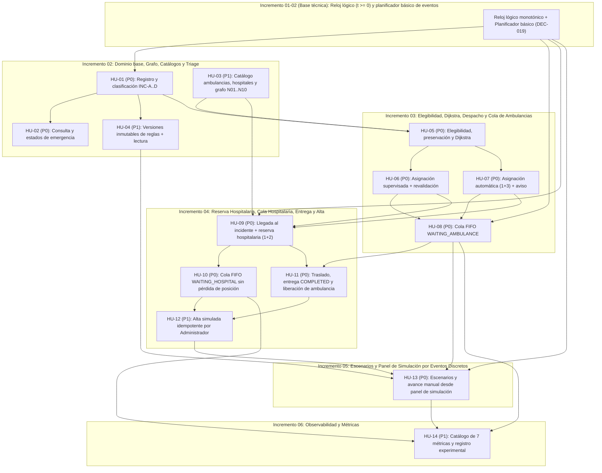

# Historias de Usuario del MVP — ARE (Arequipa RescUE)

**Estado del documento:** Aprobado — Backlog del MVP (`HU-01` a `HU-14`) alineado con la línea base aprobada (`DEC-001` a `DEC-021`, `ADR-0001`, `ADR-0002` y `business-rules.md`)
**Propósito:** Definir el backlog priorizado de **14 historias de usuario (`HU-01` a `HU-14`)** del MVP académico de **ARE – Arequipa RescUE**, como base trazable para diagramas UML, diagramas C4 en Structurizr, prototipos en Google Stitch, implementación incremental en Spring Boot y pruebas de aceptación.

---

## 1. Propósito, alcance e invariantes del modelo

Este documento traduce las decisiones funcionales aprobadas (`DEC-007` a `DEC-014` y `DEC-016` a `DEC-019`) y las reglas de negocio del MVP ([`business-rules.md`](file:///c:/Users/giovani/Documents/GitHub/ProyectoFinalTO-Arequipa-RescUE/docs/product/requirements/business-rules.md)) en **14 historias de usuario (`HU-01` a `HU-14`)** formuladas desde la perspectiva de los tres actores humanos aprobados ([`stakeholders.md`](file:///c:/Users/giovani/Documents/GitHub/ProyectoFinalTO-Arequipa-RescUE/docs/product/stakeholders.md)).

### Invariantes de alineación con `DEC-018` y `DEC-019`
1. **Conjunto cerrado de estados de emergencia (`DEC-019`, `RN-RUT-007`):** una emergencia solo puede encontrarse en uno de los **7 estados aprobados**: `REGISTERED`, `WAITING_AMBULANCE`, `ASSIGNED`, `AT_INCIDENT`, `WAITING_HOSPITAL`, `IN_TRANSPORT` y `COMPLETED`. Conceptos como clasificación/triage, despacho o desplazamiento en ruta describen acciones o transiciones dentro de dichos estados y **no constituyen estados adicionales** (no existen los estados `TRIAGED`, `DISPATCHED` ni `EN_ROUTE_TO_INCIDENT`).
2. **Conjunto cerrado de estados de ambulancia (`DEC-019`, `RN-RUT-007`):** una ambulancia solo puede encontrarse en uno de los **4 estados aprobados**: `AVAILABLE`, `ASSIGNED`, `AT_INCIDENT` y `TRANSPORTING`.
3. **Modelo hospitalario sin especialidades clínicas (`DEC-018`, `RN-HOS-001` a `RN-HOS-015`):** los hospitales del MVP no poseen especialidades clínicas ni categorías de equipamiento (`BASIC` y `SPECIALIZED` aplican exclusivamente a emergencias y ambulancias según `RN-EME-007`). La elegibilidad hospitalaria depende únicamente de: (a) estar habilitado, (b) ser alcanzable en el grafo desde el nodo del incidente y (c) contar con capacidad numérica disponible `D = C - R - O >= 1`, aplicando selección por menor costo Dijkstra, desempate por identificador estable y cola FIFO (`WAITING_HOSPITAL`).
4. **Exclusiones explícitas (`DEC-001`, `DEC-007`, `DEC-008`):** no se incluyen autenticación de usuarios, mapas reales, GPS, tráfico en tiempo real, atención o diagnóstico clínico real, cancelación de emergencias, reasignación de reservas hospitalarias confirmadas, algoritmo A\* ni envejecimiento automático (*aging*) de colas.

---

## 2. Actores humanos aprobados (`DEC-009`) y permisos operativos del MVP

Conforme a `DEC-009` y [`stakeholders.md`](file:///c:/Users/giovani/Documents/GitHub/ProyectoFinalTO-Arequipa-RescUE/docs/product/stakeholders.md), el **Motor de simulación (`CMP-INT-01`)** es un componente interno del software y nunca un actor humano. Todas las historias pertenecen a uno de los tres actores humanos:

| ID | Actor humano | Responsabilidad y permisos operativos en el backlog del MVP | Historias titulares |
| :--- | :--- | :--- | :--- |
| **`ACT-01`** | **Operador de recepción** | Registra solicitudes de emergencia, consulta su clasificación y estados del ciclo de vida, y puede consultar en **modo lectura** la versión vigente de reglas de clasificación. | `HU-01`, `HU-02` *(y consulta en lectura de `HU-04`)* |
| **`ACT-02`** | **Despachador** | Consulta ambulancias elegibles, ejecuta asignaciones supervisadas o supervisa asignaciones automáticas, gestiona colas FIFO (`WAITING_AMBULANCE` y `WAITING_HOSPITAL`), confirma llegada al incidente, reserva hospitalaria y entrega en hospital, y puede consultar en **modo lectura** la versión vigente de reglas de clasificación. | `HU-05`, `HU-06`, `HU-07`, `HU-08`, `HU-09`, `HU-10`, `HU-11` *(y consulta en lectura de `HU-04`)* |
| **`ACT-03`** | **Administrador** | Administra catálogos de ambulancias y hospitales sobre el grafo `N01`–`N10`, gestiona y publica versiones inmutables de reglas (`HU-04`), ejecuta el **alta simulada hospitalaria** (`HU-12`), controla el **avance manual por eventos discretos desde el panel de simulación** (`HU-13`) y consulta el catálogo de 7 métricas y el registro experimental (`HU-14`). | `HU-03`, `HU-04`, `HU-12`, `HU-13`, `HU-14` |

---

## 3. Tabla resumen del backlog de Historias de Usuario (`HU-01` a `HU-14`)

| ID | Título breve | Actor humano | Capacidad | Prioridad | Incremento previsto | Dependencias |
| :--- | :--- | :--- | :---: | :---: | :---: | :--- |
| **[HU-01](#hu-01--registro-y-clasificación-simulada-de-emergencia)** | Registro y clasificación simulada de emergencia | `Operador de recepción` (`ACT-01`) | A | **P0** | `02` | — |
| **[HU-02](#hu-02--consulta-y-seguimiento-del-estado-de-emergencias)** | Consulta y seguimiento del estado de emergencias | `Operador de recepción` (`ACT-01`) | A, H | **P0** | `02` | `HU-01` |
| **[HU-03](#hu-03--administración-de-ambulancias-y-hospitales-sobre-el-grafo-de-10-nodos)** | Administración de ambulancias y hospitales sobre el grafo de 10 nodos | `Administrador` (`ACT-03`) | B, F, H | **P1** | `02` | — |
| **[HU-04](#hu-04--gestión-de-versiones-inmutables-de-reglas-y-consulta-en-modo-lectura)** | Gestión de versiones inmutables de reglas y consulta en modo lectura | `Administrador` (`ACT-03`) | A, I | **P1** | `02` | `HU-01` |
| **[HU-05](#hu-05--consulta-de-ambulancias-elegibles-ordenadas-por-preservación-y-dijkstra)** | Consulta de ambulancias elegibles ordenadas por preservación y Dijkstra | `Despachador` (`ACT-02`) | C, H | **P0** | `03` | `HU-01`, `HU-03` |
| **[HU-06](#hu-06--asignación-supervisada-de-ambulancia-con-revalidación-concurrente)** | Asignación supervisada de ambulancia con revalidación concurrente | `Despachador` (`ACT-02`) | D, H | **P0** | `03` | `HU-05` |
| **[HU-07](#hu-07--asignación-automática-de-ambulancia-con-reintentos-acotados-y-aviso-de-agotamiento)** | Asignación automática de ambulancia con reintentos acotados y aviso de agotamiento | `Despachador` (`ACT-02`) | D, H | **P0** | `03` | `HU-05` |
| **[HU-08](#hu-08--gestión-y-atención-fifo-de-la-cola-de-emergencias-en-espera-de-ambulancia)** | Gestión y atención FIFO de la cola de emergencias en espera de ambulancia | `Despachador` (`ACT-02`) | E, H | **P0** | `03` | `HU-06`, `HU-07` |
| **[HU-09](#hu-09--confirmación-de-llegada-al-incidente-y-reserva-hospitalaria-concurrente)** | Confirmación de llegada al incidente y reserva hospitalaria concurrente | `Despachador` (`ACT-02`) | F, G, H | **P0** | `04` | `HU-03`, `HU-06`, `HU-07` |
| **[HU-10](#hu-10--gestión-y-reevaluación-fifo-de-emergencias-en-espera-de-destino-hospitalario)** | Gestión y reevaluación FIFO de emergencias en espera de destino hospitalario | `Despachador` (`ACT-02`) | F, G | **P0** | `04` | `HU-09` |
| **[HU-11](#hu-11--traslado-entrega-simulada-en-hospital-y-liberación-inmediata-de-ambulancia)** | Traslado, entrega simulada en hospital y liberación inmediata de ambulancia | `Despachador` (`ACT-02`) | F, H | **P0** | `04` | `HU-08`, `HU-09` |
| **[HU-12](#hu-12--ejecución-idempotente-de-alta-simulada-hospitalaria-y-liberación-de-plaza)** | Ejecución idempotente de alta simulada hospitalaria y liberación de plaza | `Administrador` (`ACT-03`) | F, G | **P1** | `04` | `HU-10`, `HU-11` |
| **[HU-13](#hu-13--ejecución-de-escenarios-y-avance-manual-por-eventos-discretos-desde-el-panel-de-simulación)** | Ejecución de escenarios y avance manual por eventos discretos desde el panel de simulación | `Administrador` (`ACT-03`) | I | **P0** | `05` | `HU-01`, `HU-03`, `HU-04`, `HU-06` a `HU-12` |
| **[HU-14](#hu-14--consulta-del-catálogo-de-7-métricas-y-registro-experimental-trazable)** | Consulta del catálogo de 7 métricas y registro experimental trazable | `Administrador` (`ACT-03`) | J | **P1** | `06` | `HU-08`, `HU-10`, `HU-13` |

*(Leyenda de capacidades del MVP: **A** Registro/clasificación de emergencias; **B** Gestión de ambulancias; **C** Elegibilidad/recomendación; **D** Asignación supervisada/automática; **E** Cola `WAITING_AMBULANCE`; **F** Gestión/selección/reserva/alta hospitalaria; **G** Cola `WAITING_HOSPITAL`; **H** Grafo/rutas/estados; **I** Administración/escenarios/simulación; **J** Métricas/registro experimental).*

---

## 4. Historias de Usuario detalladas

### HU-01 — Registro y clasificación simulada de emergencia

**Actor:** `Operador de recepción` (`ACT-01`).

**Historia (objetivo y valor):**
Como `Operador de recepción`,
quiero registrar una solicitud de emergencia ingresando su categoría de incidente (`INC-A`, `INC-B`, `INC-C` o `INC-D`), su nodo de ubicación en el grafo de Arequipa (`N01` a `N10`) y una descripción ficticia opcional,
para que el sistema la cree en estado `REGISTERED` y determine de forma reproducible su prioridad simulada informativa y el equipamiento requerido (`BASIC` o `SPECIALIZED`) según la versión activa de reglas.

**Prioridad:** P0.

**Referencias trazables:**
- **Reglas de negocio:** `RN-EME-001` a `RN-EME-010`, `RN-ASI-004`, `RN-RUT-006`, `RN-RUT-007`.
- **Criterios de aceptación:** `CA-SIM-03`.
- **Decisiones funcionales:** `DEC-007`, `DEC-008`, `DEC-009`, `DEC-010`, `DEC-016`, `DEC-019`.

**Criterios de aceptación:**
1. **Dado** que existe una versión activa de reglas con el catálogo inicial (`INC-A` $\to$ `Alta`/`SPECIALIZED`, `INC-B` $\to$ `Media`/`BASIC`, `INC-C` $\to$ `Baja`/`BASIC`, `INC-D` $\to$ `Alta`/`BASIC`), **cuando** el `Operador de recepción` registra una emergencia con categoría válida, nodo perteneciente a `N01`–`N10` y descripción vacía o con texto, **entonces** el sistema persiste la emergencia en estado `REGISTERED` con identificador estable (`EMG-XXXXX`), marca de tiempo lógico $t$ de registro, prioridad informativa, equipamiento requerido (`BASIC` o `SPECIALIZED`) y referencia inmutable a la versión activa de reglas aplicada (`RN-EME-004`, `RN-EME-009`).
2. **Dado** el formulario de registro, **cuando** el `Operador de recepción` intenta registrar una solicitud sin categoría, con categoría inexistente/inactiva o con un nodo fuera de `N01`–`N10`, **entonces** el sistema rechaza la operación sin persistir datos ni aplicar clasificaciones por defecto (`RN-EME-010`).
3. **Dado** que una emergencia válida ha sido registrada en `REGISTERED` y al evaluarse inicialmente no existen ambulancias elegibles disponibles, **cuando** concluye la evaluación inicial, **entonces** el registro se conserva y la emergencia transita a `WAITING_AMBULANCE` con `0` reintentos consumidos (`RN-EME-010`, `RN-ASI-004`).

**Dependencias:** Ninguna *(utiliza el reloj lógico base $t \ge 0$ provisto en la infraestructura de dominio desde el inicio de la construcción)*.

**Incremento previsto:** 02.

---

### HU-02 — Consulta y seguimiento del estado de emergencias

**Actor:** `Operador de recepción` (`ACT-01`).

**Historia (objetivo y valor):**
Como `Operador de recepción`,
quiero consultar el listado y el detalle actualizado de las emergencias registradas junto con su estado operativo aprobado, recursos asociados y versión de reglas aplicada,
para dar seguimiento trazable a cada solicitud desde `REGISTERED` hasta `COMPLETED`.

**Prioridad:** P0.

**Referencias trazables:**
- **Reglas de negocio:** `RN-EME-001`, `RN-EME-004`, `RN-EME-006`, `RN-EME-008`, `RN-EME-009`, `RN-RUT-005`, `RN-RUT-007`.
- **Criterios de aceptación:** `CA-SIM-03`.
- **Decisiones funcionales:** `DEC-007`, `DEC-009`, `DEC-016`, `DEC-019`.

**Criterios de aceptación:**
1. **Dado** que existen emergencias en el sistema, **cuando** el `Operador de recepción` consulta el listado o detalle de emergencias, **entonces** visualiza para cada solicitud su identificador, categoría, nodo, prioridad informativa, equipamiento requerido, versión de reglas aplicada, ambulancia asignada (si existe), hospital reservado/ocupado (si existe) y su estado actual perteneciente exclusivamente a `{REGISTERED, WAITING_AMBULANCE, ASSIGNED, AT_INCIDENT, WAITING_HOSPITAL, IN_TRANSPORT, COMPLETED}` (`CA-SIM-03`).
2. **Dado** que una emergencia se encuentra en `WAITING_HOSPITAL`, **cuando** se consulta su detalle, **entonces** el sistema muestra explícitamente que espera destino hospitalario conservando su ambulancia asignada y ocupada en estado `AT_INCIDENT`, diferenciándola de `WAITING_AMBULANCE` (`RN-RUT-007`).
3. **Dado** que una emergencia alcanza el estado `COMPLETED` al arribar al hospital reservado, **cuando** se consulta su ficha, **entonces** se visualizan las marcas de tiempo lógico $t$ de sus transiciones y el ciclo figura cerrado sin etapas intrahospitalarias posteriores (`RN-EME-001`, `RN-RUT-005`).

**Dependencias:** `HU-01`.

**Incremento previsto:** 02.

---

### HU-03 — Administración de ambulancias y hospitales sobre el grafo de 10 nodos

**Actor:** `Administrador` (`ACT-03`).

**Historia (objetivo y valor):**
Como `Administrador`,
quiero administrar y consultar el catálogo de ambulancias (`BASIC` y `SPECIALIZED`) y de hospitales (habilitación y capacidad numérica simulada `C`, `R`, `O`, `D` sin especialidades clínicas) ubicados sobre los 10 nodos del grafo de Arequipa (`N01` a `N10`),
para configurar los recursos operativos base preservando las invariantes de capacidad y el bloqueo durante escenarios activos.

**Prioridad:** P1.

**Referencias trazables:**
- **Reglas de negocio:** `RN-EME-007`, `RN-ELE-002`, `RN-RUT-001`, `RN-RUT-006`, `RN-RUT-007`, `RN-HOS-001`, `RN-HOS-004`, `RN-HOS-015`.
- **Criterios de aceptación:** `CA-HOS-12`, `CA-SIM-05`.
- **Decisiones funcionales:** `DEC-008`, `DEC-009`, `DEC-013`, `DEC-014`, `DEC-018`, `DEC-019`.

**Criterios de aceptación:**
1. **Dado** que no hay un escenario experimental activo, **cuando** el `Administrador` registra o actualiza una ambulancia o un hospital sobre un nodo válido (`N01` a `N10`), **entonces** el sistema valida que la ambulancia tenga equipamiento `BASIC` o `SPECIALIZED` y estado dentro de `{AVAILABLE, ASSIGNED, AT_INCIDENT, TRANSPORTING}`, y que el hospital mantenga `C >= 0`, `R >= 0`, `O >= 0`, `R + O <= C` y `D = C - R - O >= 0` sin exigir ni asignar especialidades hospitalarias (`RN-HOS-004`).
2. **Dado** que existe un escenario experimental en curso, **cuando** el `Administrador` intenta modificar la capacidad total `C` de un hospital, **entonces** el sistema rechaza la operación conforme a `RN-HOS-015` y `CA-HOS-12`.
3. **Dado** que no hay un escenario experimental en curso pero un hospital registra plazas reservadas u ocupadas (`R + O > 0`), **cuando** el `Administrador` intenta fijar `C < R + O`, **entonces** el sistema rechaza la modificación preservando `R + O <= C` (`CA-HOS-12`).
4. **Dado** el grafo inicial (`N01` a `N10` con 11 aristas ponderadas en unidades abstractas entre `N01`–`N09` y `N10` aislado), **cuando** el `Administrador` consulta la topología, **entonces** visualiza los nodos, los costos enteros positivos de cada arista y la condición de nodo sin aristas activas de `N10` (`RN-RUT-006`, `CA-SIM-05`).

**Dependencias:** Ninguna.

**Incremento previsto:** 02.

---

### HU-04 — Gestión de versiones inmutables de reglas y consulta en modo lectura

**Actor:** `Administrador` (`ACT-03`) *(con permiso de consulta en modo lectura para `Operador de recepción` [`ACT-01`] y `Despachador` [`ACT-02`])*.

**Historia (objetivo y valor):**
Como `Administrador`,
quiero publicar y activar nuevas versiones inmutables del catálogo de reglas de clasificación (`INC-A` a `INC-D`) fuera de escenarios activos —permitiendo además que recepción y despacho consulten en modo lectura la versión vigente—,
para evolucionar los parámetros de clasificación sin alterar retroactivamente emergencias previas y dar transparencia operativa sobre la regla activa.

**Prioridad:** P1.

**Referencias trazables:**
- **Reglas de negocio:** `RN-EME-002` a `RN-EME-008`, `RN-EME-011`, `RN-EME-012`.
- **Criterios de aceptación:** Validaciones de versionado e inmutabilidad (`DEC-016`).
- **Decisiones funcionales:** `DEC-009`, `DEC-010`, `DEC-016`.

**Criterios de aceptación:**
1. **Dado** que no hay un escenario experimental activo, **cuando** el `Administrador` publica y activa una nueva versión de reglas (`RUL-VXX`) que define sin omisiones, duplicados ni contradicciones las categorías `INC-A` a `INC-D` hacia prioridades `{Alta, Media, Baja}` y equipamiento `{BASIC, SPECIALIZED}`, **entonces** dicha versión queda activa para nuevos registros y las versiones previas se conservan inmutables (`RN-EME-011`).
2. **Dado** que existen emergencias registradas bajo una versión anterior (`RUL-V01`), **cuando** se activa una nueva versión (`RUL-V02`), **entonces** las emergencias anteriores mantienen intacta su clasificación y su referencia a `RUL-V01` (`RN-EME-004`, `RN-EME-011`).
3. **Dado** que un escenario experimental está activo, **cuando** el `Administrador` intenta publicar o activar una versión de reglas, **entonces** el sistema rechaza la operación (`RN-EME-012`).
4. **Dado** un borrador con categorías faltantes, duplicadas o valores fuera de catálogo, **cuando** el `Administrador` intenta publicarlo, **entonces** el sistema rechaza la publicación informando la causa de validación (`RN-EME-011`).
5. **Dado** que existe una versión activa de reglas, **cuando** el `Operador de recepción` (`ACT-01`) o el `Despachador` (`ACT-02`) acceden a la consulta de reglas, **entonces** visualizan en **modo de solo lectura** la versión vigente y su tabla de correspondencia (`INC-A` a `INC-D`), sin controles para crear, editar, publicar ni activar versiones (`DEC-009`).

**Dependencias:** `HU-01`.

**Incremento previsto:** 02.

---

### HU-05 — Consulta de ambulancias elegibles ordenadas por preservación y Dijkstra

**Actor:** `Despachador` (`ACT-02`).

**Historia (objetivo y valor):**
Como `Despachador`,
quiero consultar para una emergencia en `REGISTERED` o `WAITING_AMBULANCE` las ambulancias elegibles ordenadas por preservación de unidades especializadas, menor costo de ruta calculado con Dijkstra y desempate determinista por identificador estable,
para conocer las alternativas válidas de despacho con total independencia de la disponibilidad hospitalaria.

**Prioridad:** P0.

**Referencias trazables:**
- **Reglas de negocio:** `RN-EME-007`, `RN-EME-008`, `RN-ELE-001` a `RN-ELE-004`, `RN-ASI-005`, `RN-PRE-001` a `RN-PRE-003`, `RN-RUT-001` a `RN-RUT-004`, `RN-RUT-006`, `RN-HOS-002`.
- **Criterios de aceptación:** `CA-SIM-02`, `CA-SIM-05`.
- **Decisiones funcionales:** `DEC-011`, `DEC-013`, `DEC-014`, `DEC-016`, `DEC-019`.

**Criterios de aceptación:**
1. **Dado** que una emergencia requiere equipamiento `SPECIALIZED`, **cuando** se evalúa la elegibilidad, **entonces** solo se incluyen ambulancias en estado `AVAILABLE`, alcanzables en el grafo y con equipamiento `SPECIALIZED`, excluyendo toda unidad `BASIC` (`RN-ELE-002`, `RN-PRE-003`).
2. **Dado** que una emergencia requiere equipamiento `BASIC`, **cuando** existen ambulancias `BASIC` y `SPECIALIZED` disponibles y alcanzables, **entonces** el sistema prefiere las unidades `BASIC` y solo habilita/recomienda unidades `SPECIALIZED` cuando no existe ninguna `BASIC` elegible (`RN-PRE-001`, `RN-PRE-002`).
3. **Dado** que dos o más ambulancias elegibles del mismo grupo presentan igual costo mínimo de ruta por Dijkstra hacia el nodo del incidente, **cuando** el sistema ordena la lista, **entonces** aplica desempate ascendente por identificador estable (`AMB-01` antes que `AMB-02`, `RN-ASI-005`, `CA-SIM-02`), sin que intervengan la prioridad informativa (`RN-EME-008`) ni la capacidad hospitalaria (`RN-ELE-004`, `RN-HOS-002`).
4. **Dado** un incidente ubicado en el nodo aislado `N10` (o sin camino hacia ambulancias `AVAILABLE`), **cuando** se ejecuta Dijkstra, **entonces** las unidades sin ruta válida se descartan como no elegibles (`CA-SIM-05`).

**Dependencias:** `HU-01`, `HU-03`.

**Incremento previsto:** 03.

---

### HU-06 — Asignación supervisada de ambulancia con revalidación concurrente

**Actor:** `Despachador` (`ACT-02`).

**Historia (objetivo y valor):**
Como `Despachador`,
quiero seleccionar manualmente en modalidad supervisada cualquier ambulancia elegible para asignarla a una emergencia,
para concretar el despacho hacia el incidente (`ASSIGNED`) o recibir una lista actualizada de unidades elegibles si otra operación concurrente tomó antes la unidad seleccionada.

**Prioridad:** P0.

**Referencias trazables:**
- **Reglas de negocio:** `RN-ASI-001`, `RN-ASI-002`, `RN-ASI-004`, `RN-CON-001`, `RN-CON-002`, `RN-CON-005`, `RN-RUT-007`.
- **Criterios de aceptación:** `CA-CON-07`, `CA-CON-10`, `CA-SIM-03`.
- **Decisiones funcionales:** `DEC-011`, `DEC-017`, `DEC-019` *(soportada técnicamente por `DEC-021` / `ADR-0002`)*.

**Criterios de aceptación:**
1. **Dado** que en modalidad supervisada existen ambulancias elegibles, **cuando** el `Despachador` selecciona cualquiera de ellas (aunque no sea la primera recomendada) y la unidad continúa `AVAILABLE` al confirmar, **entonces** la emergencia pasa a `ASSIGNED` y la ambulancia pasa de `AVAILABLE` a `ASSIGNED` (`RN-ASI-002`, `RN-RUT-007`).
2. **Dado** que el `Despachador` intenta confirmar una ambulancia en modalidad supervisada, **cuando** otra operación concurrente tomó o cambió el estado de esa ambulancia antes de confirmarse la asignación, **entonces** el sistema rechaza la operación impidiendo la doble asignación (`RN-CON-001`, `CA-CON-07`), no aplica los 3 reintentos automáticos (`RN-CON-005`), actualiza la lista de ambulancias elegibles y solicita una nueva selección manual al `Despachador` (`RN-CON-002`, `CA-CON-10`).
3. **Dado** que tras actualizar las alternativas ya no quedan ambulancias elegibles disponibles, **cuando** se presenta el resultado al `Despachador`, **entonces** la emergencia pasa o permanece en `WAITING_AMBULANCE` (`RN-ASI-004`).

**Dependencias:** `HU-05`.

**Incremento previsto:** 03.

---

### HU-07 — Asignación automática de ambulancia con reintentos acotados y aviso de agotamiento

**Actor:** `Despachador` (`ACT-02`).

**Historia (objetivo y valor):**
Como `Despachador`,
quiero que en modalidad automática el sistema asigne inmediatamente la ambulancia óptima y, ante conflictos concurrentes de disponibilidad, ejecute hasta 3 reintentos adicionales con reevaluación integral o me notifique en pantalla si se agotan los intentos,
para asegurar despachos consistentes sin doble asignación y detectar las emergencias que quedaron en `WAITING_AMBULANCE` por contención.

**Prioridad:** P0.

**Referencias trazables:**
- **Reglas de negocio:** `RN-ASI-001`, `RN-ASI-003` a `RN-ASI-005`, `RN-PRE-001` a `RN-PRE-003`, `RN-CON-001`, `RN-CON-003` a `RN-CON-009`, `RN-RUT-007`.
- **Criterios de aceptación:** `CA-CON-01` a `CA-CON-09`, `CA-SIM-02`, `CA-SIM-03`.
- **Decisiones funcionales:** `DEC-011`, `DEC-017`, `DEC-019` *(soportada técnicamente por `DEC-021` / `ADR-0002`)*.

**Criterios de aceptación:**
1. **Dado** que en modalidad automática la ambulancia óptima sigue `AVAILABLE` al confirmar, **cuando** se ejecuta el intento inicial, **entonces** la emergencia y la ambulancia pasan a `ASSIGNED` con `0` reintentos consumidos (`CA-CON-01`).
2. **Dado** que un intento en modalidad automática falla por conflicto concurrente de disponibilidad sobre la ambulancia objetivo y existen otras candidatas dentro del límite de **1 intento inicial + hasta 3 reintentos adicionales (máximo 4 intentos)**, **cuando** el sistema ejecuta el reintento, **entonces** impide cualquier doble asignación simultánea (`CA-CON-07`), recalcula integralmente disponibilidad, elegibilidad, compatibilidad `BASIC`/`SPECIALIZED`, preservación de especializadas, costo Dijkstra y desempate `RN-ASI-005`, y confirma la nueva unidad deteniendo el ciclo (`CA-CON-02`, `CA-CON-03`, `CA-CON-08`, `CA-CON-09`).
3. **Dado** que no existen ambulancias elegibles en el intento inicial (`0` reintentos) o que tras un conflicto concurrente la reevaluación determina que ya no quedan ambulancias elegibles, **cuando** se evalúa la operación, **entonces** finaliza anticipadamente sin consumir reintentos vacíos y la emergencia queda en `WAITING_AMBULANCE` (`CA-CON-04`, `CA-CON-05`).
4. **Dado** que fallan el intento inicial y los 3 reintentos adicionales por conflictos concurrentes, **cuando** se agota el límite de 4 intentos, **entonces** la emergencia permanece en `WAITING_AMBULANCE`, se registra el resultado funcional con motivo `CONCURRENCY_RETRY_EXHAUSTED` (4 intentos ejecutados, 3 reintentos consumidos) y se muestra un aviso visible al `Despachador` en la interfaz web indicando la emergencia pendiente, el motivo de agotamiento y que la operación terminó sin asignación (`RN-CON-007`, `RN-CON-008`, `CA-CON-06`).
5. **Dado** que ocurre un fallo técnico general ajeno a un conflicto concurrente de disponibilidad, **cuando** se procesa la operación, **entonces** no se consumen reintentos de concurrencia ni se registra como `CONCURRENCY_RETRY_EXHAUSTED` (`RN-CON-005`, `RN-CON-008`).

**Dependencias:** `HU-05`.

**Incremento previsto:** 03.

---

### HU-08 — Gestión y atención FIFO de la cola de emergencias en espera de ambulancia

**Actor:** `Despachador` (`ACT-02`).

**Historia (objetivo y valor):**
Como `Despachador`,
quiero visualizar la cola de emergencias en `WAITING_AMBULANCE` y que, cuando una ambulancia pase a `AVAILABLE`, el sistema evalúe y atienda automáticamente la emergencia elegible más antigua según su grupo de equipamiento (`SPECIALIZED` o `BASIC`) y orden FIFO estricto sin *aging*,
para asignar de forma determinista las unidades liberadas iniciando un contador nuevo de intentos por operación.

**Prioridad:** P0.

**Referencias trazables:**
- **Reglas de negocio:** `RN-EME-008`, `RN-ASI-004`, `RN-CON-009`, `RN-COL-001` a `RN-COL-007`, `RN-RUT-007`, `RN-RUT-008`.
- **Criterios de aceptación:** `CA-SIM-01`, `CA-SIM-03`.
- **Decisiones funcionales:** `DEC-012`, `DEC-016`, `DEC-017`, `DEC-019` *(soportada técnicamente por `DEC-021` / `ADR-0002`)*.

**Criterios de aceptación:**
1. **Dado** que existen emergencias en `WAITING_AMBULANCE`, **cuando** una ambulancia `SPECIALIZED` pasa a `AVAILABLE`, **entonces** el sistema evalúa primero el grupo de emergencias en `WAITING_AMBULANCE` que requieren equipamiento `SPECIALIZED` en orden FIFO (`RN-COL-001`, `RN-COL-003`) y, solo si no existe ninguna alcanzable en ese grupo, evalúa en segundo lugar el grupo `BASIC` en orden FIFO (`RN-COL-002`).
2. **Dado** que existen emergencias en `WAITING_AMBULANCE`, **cuando** una ambulancia `BASIC` pasa a `AVAILABLE`, **entonces** el sistema evalúa únicamente las emergencias que requieren equipamiento `BASIC` en estricto orden FIFO (con desempate por identificador estable y sin alterar el orden por prioridad informativa ni *aging*); si solo existen emergencias `SPECIALIZED` o ninguna compatible y alcanzable, la ambulancia permanece `AVAILABLE` (`RN-COL-005`, `RN-COL-007`, `CA-SIM-01`).
3. **Dado** que una emergencia en `WAITING_AMBULANCE` había agotado reintentos en una operación anterior, **cuando** el paso de una ambulancia a `AVAILABLE` dispara una nueva operación independiente de asignación, **entonces** dicha operación inicia su contador de intentos desde cero (1 intento inicial + hasta 3 reintentos adicionales, `RN-CON-009`).

**Dependencias:** `HU-06`, `HU-07`.

**Incremento previsto:** 03.

---

### HU-09 — Confirmación de llegada al incidente y reserva hospitalaria concurrente

**Actor:** `Despachador` (`ACT-02`).

**Historia (objetivo y valor):**
Como `Despachador`,
quiero que al confirmarse la llegada de la ambulancia al nodo del incidente y la recogida de la emergencia (`AT_INCIDENT`), el sistema seleccione automáticamente el hospital habilitado, alcanzable y con plaza disponible (`D = C - R - O >= 1`) de menor costo por Dijkstra y confirme la reserva de plaza (`R`) con hasta 2 reintentos ante conflictos concurrentes,
para iniciar el traslado (`IN_TRANSPORT`) solo con destino hospitalario confirmado y preservando `R + O <= C`.

**Prioridad:** P0.

**Referencias trazables:**
- **Reglas de negocio:** `RN-RUT-002`, `RN-RUT-007`, `RN-HOS-001`, `RN-HOS-004` a `RN-HOS-009`.
- **Criterios de aceptación:** `CA-HOS-01` a `CA-HOS-07`, `CA-SIM-03`.
- **Decisiones funcionales:** `DEC-013`, `DEC-014`, `DEC-018`, `DEC-019` *(soportada técnicamente por `DEC-021` / `ADR-0002`)*.

**Criterios de aceptación:**
1. **Dado** que la ambulancia llega al nodo del incidente y se confirma la recogida (la emergencia pasa de `ASSIGNED` a `AT_INCIDENT` y la ambulancia de `ASSIGNED` a `AT_INCIDENT`), **cuando** existen hospitales habilitados, alcanzables en el grafo y con `D = C - R - O >= 1` (sin aplicar filtros de especialidad clínica), **entonces** el sistema descarta hospitales con `D = 0` o inalcanzables (`CA-HOS-01`, `CA-HOS-03`), selecciona el de menor costo de ruta por Dijkstra con desempate ascendente por identificador estable (`HOSP-01` antes que `HOSP-02`, `RN-HOS-006`, `CA-HOS-02`), incrementa `R = R + 1` (`D = D - 1`) y transita la emergencia a `IN_TRANSPORT` y la ambulancia a `TRANSPORTING` (`RN-HOS-007`, `RN-RUT-007`).
2. **Dado** que dos operaciones concurrentes compiten por la última plaza disponible (`D = 1`) de un mismo hospital, **cuando** ejecutan su intento de reserva, **entonces** a lo sumo una confirma la reserva preservando `R + O <= C` (`D` pasa a `0`), mientras la otra reevalúa integralmente los hospitales restantes dentro de su límite independiente de **1 intento inicial + hasta 2 reintentos adicionales (máximo 3 intentos)**, deteniéndose en cuanto confirma una reserva válida o ya no quedan hospitales elegibles (`RN-HOS-008`, `CA-HOS-04`, `CA-HOS-06`).
3. **Dado** que al confirmar la recogida no existe ningún hospital elegible desde el intento inicial (`0` reintentos consumidos) o se agotan el intento inicial y los 2 reintentos adicionales por conflictos concurrentes (`HOSPITAL_RESERVATION_RETRY_EXHAUSTED`), **cuando** finaliza la operación, **entonces** la emergencia no inicia traslado, pasa a `WAITING_HOSPITAL` conservando su ambulancia asignada y ocupada en estado `AT_INCIDENT`, y registra el motivo funcional correspondiente (`RN-HOS-009`, `CA-HOS-05`, `CA-HOS-07`, `CA-SIM-03`).

**Dependencias:** `HU-03`, `HU-06`, `HU-07`.

**Incremento previsto:** 04.

---

### HU-10 — Gestión y reevaluación FIFO de emergencias en espera de destino hospitalario

**Actor:** `Despachador` (`ACT-02`).

**Historia (objetivo y valor):**
Como `Despachador`,
quiero supervisar la cola FIFO de emergencias en `WAITING_HOSPITAL` y que, al liberarse capacidad hospitalaria (`D >= 1`), el sistema las reevalúe automáticamente sin hacer perder su posición a las emergencias para las cuales el hospital liberado sea inalcanzable,
para que cada emergencia con ambulancia retenida en `AT_INCIDENT` inicie su traslado en cuanto disponga de un hospital habilitado y alcanzable con plaza disponible.

**Prioridad:** P0.

**Referencias trazables:**
- **Reglas de negocio:** `RN-RUT-007`, `RN-HOS-005` a `RN-HOS-011`.
- **Criterios de aceptación:** `CA-HOS-08`, `CA-HOS-09`, `CA-SIM-03`.
- **Decisiones funcionales:** `DEC-018`, `DEC-019` *(soportada técnicamente por `DEC-021` / `ADR-0002`)*.

**Criterios de aceptación:**
1. **Dado** que existen emergencias en `WAITING_HOSPITAL`, **cuando** aumenta la disponibilidad de un hospital (`D >= 1`), **entonces** el sistema reevalúa automáticamente la cola en estricto orden FIFO según el instante de ingreso a `WAITING_HOSPITAL` (con desempate por identificador estable), iniciando para cada operación independiente un contador nuevo de intentos hospitalarios desde cero (hasta 1 intento inicial + 2 reintentos adicionales, `RN-HOS-010`, `RN-HOS-011`, `CA-HOS-08`).
2. **Dado** que durante la reevaluación automática la primera emergencia de la cola `WAITING_HOSPITAL` no tiene ningún hospital elegible (por ejemplo, porque el hospital que liberó plaza es inalcanzable en el grafo desde el nodo del incidente), **cuando** el sistema procesa la cola, **entonces** dicha emergencia permanece en `WAITING_HOSPITAL` conservando su posición original en la cola sin ser desplazada al final y el sistema evalúa la siguiente emergencia en espera (`RN-HOS-011`, `CA-HOS-09`).
3. **Dado** que una emergencia en `WAITING_HOSPITAL` confirma la reserva de una plaza (`R = R + 1`) durante la reevaluación, **cuando** concluye el intento, **entonces** la emergencia pasa de `WAITING_HOSPITAL` a `IN_TRANSPORT` y su ambulancia pasa de `AT_INCIDENT` a `TRANSPORTING` (`RN-RUT-007`).

**Dependencias:** `HU-09`.

**Incremento previsto:** 04.

---

### HU-11 — Traslado, entrega simulada en hospital y liberación inmediata de ambulancia

**Actor:** `Despachador` (`ACT-02`).

**Historia (objetivo y valor):**
Como `Despachador`,
quiero que al completarse el desplazamiento de una emergencia en `IN_TRANSPORT` hacia el hospital reservado y confirmarse la entrega simulada, la emergencia pase a `COMPLETED`, la reserva (`R`) se transforme en ocupación (`O`) y la ambulancia pase inmediatamente de `TRANSPORTING` a `AVAILABLE` en el nodo del hospital,
para cerrar el ciclo de la emergencia y liberar de inmediato la unidad móvil sin esperar al alta simulada hospitalaria.

**Prioridad:** P0.

**Referencias trazables:**
- **Reglas de negocio:** `RN-EME-001`, `RN-COL-001`, `RN-COL-007`, `RN-RUT-005`, `RN-RUT-007`, `RN-RUT-008`, `RN-HOS-003`, `RN-HOS-012`, `RN-HOS-014`.
- **Criterios de aceptación:** `CA-HOS-10`, `CA-HOS-13`, `CA-SIM-03`, `CA-SIM-04`.
- **Decisiones funcionales:** `DEC-007`, `DEC-012`, `DEC-018`, `DEC-019`.

**Criterios de aceptación:**
1. **Dado** que una emergencia se encuentra en `IN_TRANSPORT` con su ambulancia en `TRANSPORTING` y reserva confirmada en un hospital, **cuando** arriba al nodo del hospital y se confirma la entrega simulada, **entonces** la reserva se transforma en ocupación (`R = R - 1`, `O = O + 1` y `D = C - R - O` permanece igual), sin consumir una segunda plaza y conservando su validez aunque el hospital hubiera llegado a `D = 0` antes del arribo (`RN-HOS-012`, `CA-HOS-10`).
2. **Dado** que se confirma la entrega simulada en el hospital, **cuando** la emergencia pasa de `IN_TRANSPORT` a `COMPLETED`, **entonces** la ambulancia actualiza su ubicación al nodo de dicho hospital, pasa inmediatamente de `TRANSPORTING` a `AVAILABLE` con total independencia del alta hospitalaria posterior (`RN-RUT-008`, `RN-HOS-014`, `CA-HOS-13`, `CA-SIM-04`) y dispara la evaluación de la cola `WAITING_AMBULANCE` según su equipamiento (`BASIC` o `SPECIALIZED`).

**Dependencias:** `HU-08`, `HU-09`.

**Incremento previsto:** 04.

---

### HU-12 — Ejecución idempotente de alta simulada hospitalaria y liberación de plaza

**Actor:** `Administrador` (`ACT-03`).

**Historia (objetivo y valor):**
Como `Administrador`,
quiero ejecutar explícitamente el evento de alta simulada sobre una plaza hospitalaria ocupada (`O`),
para liberar exactamente una plaza (`O = O - 1`, `D = D + 1`), impedir duplicidades ante invocaciones repetidas o concurrentes y disparar automáticamente la reevaluación FIFO de la cola `WAITING_HOSPITAL`.

**Prioridad:** P1.

**Referencias trazables:**
- **Reglas de negocio:** `RN-RUT-008`, `RN-HOS-003`, `RN-HOS-004`, `RN-HOS-011`, `RN-HOS-013`, `RN-HOS-014`.
- **Criterios de aceptación:** `CA-HOS-08`, `CA-HOS-11`, `CA-HOS-13`.
- **Decisiones funcionales:** `DEC-007`, `DEC-009`, `DEC-018`, `DEC-019` *(soportada técnicamente por `DEC-021` / `ADR-0002`)*.

**Criterios de aceptación:**
1. **Dado** que un hospital mantiene al menos una plaza ocupada activa (`O >= 1` asociada a una entrega completada), **cuando** el `Administrador` ejecuta el alta simulada sobre dicha ocupación, **entonces** el sistema reduce `O = O - 1`, incrementa `D = D + 1`, marca el registro de ocupación hospitalaria como liberado y activa automáticamente la reevaluación FIFO de `WAITING_HOSPITAL` (`RN-HOS-011`, `RN-HOS-013`, `CA-HOS-08`, `CA-HOS-11`).
2. **Dado** que una ocupación hospitalaria ya fue liberada mediante alta simulada, **cuando** se intenta ejecutar nuevamente el alta simulada sobre esa misma ocupación (de forma secuencial o concurrente), **entonces** el sistema rechaza o ignora el duplicado sin volver a alterar `O` ni `D` (`RN-HOS-013`, `CA-HOS-11`).
3. **Dado** que el `Administrador` ejecuta un alta simulada hospitalaria, **cuando** se libera la plaza `O`, **entonces** esta operación no modifica los estados de emergencia (`COMPLETED`) ni de ambulancia (`AVAILABLE`, ya liberada al momento de la entrega en `HU-11`) (`RN-HOS-014`, `CA-HOS-13`).

**Dependencias:** `HU-10`, `HU-11`.

**Incremento previsto:** 04.

---

### HU-13 — Ejecución de escenarios y avance manual por eventos discretos desde el panel de simulación

**Actor:** `Administrador` (`ACT-03`).

**Historia (objetivo y valor):**
Como `Administrador`,
quiero configurar e iniciar escenarios experimentales y controlar manualmente el avance paso a paso al siguiente evento discreto pendiente desde el panel de simulación,
para conducir de forma reproducible la evolución del tiempo lógico ($t \ge 0$), verificar el desempate determinista de eventos simultáneos y mantener bloqueados los cambios estructurales mientras el escenario está activo.

**Prioridad:** P0.

**Referencias trazables:**
- **Reglas de negocio:** `RN-EME-006`, `RN-EME-012`, `RN-ASI-001`, `RN-RUT-007`, `RN-RUT-009`, `RN-HOS-015`, `RN-MET-001`.
- **Criterios de aceptación:** `CA-HOS-12`, `CA-SIM-06`, `CA-SIM-07`.
- **Decisiones funcionales:** `DEC-008`, `DEC-009`, `DEC-016`, `DEC-018`, `DEC-019` *(soportada técnicamente por `DEC-021` / `ADR-0002`)*.

**Criterios de aceptación:**
1. **Dado** un escenario experimental iniciado desde el panel de simulación con eventos pendientes en el planificador, **cuando** el `Administrador` acciona manualmente el control de avance al siguiente evento desde dicho panel, **entonces** el motor (`CMP-INT-01`) ejecuta el evento de menor tiempo lógico $t$ y actualiza el reloj lógico de manera monotónica no negativa ($t_{\text{nuevo}} \ge t_{\text{anterior}} \ge 0$) en unidades abstractas, sin utilizar relojes acelerados, temporizadores de tiempo físico ni procesos continuos en segundo plano (`RN-RUT-009`, `CA-SIM-06`).
2. **Dado** que dos o más eventos pendientes comparten exactamente el mismo tiempo lógico ($t_a = t_b$), **cuando** el `Administrador` avanza paso a paso la simulación, **entonces** el planificador los procesa en orden determinista aplicando primero la precedencia fija por tipo de evento —(1.°) liberación de recursos (entrega hospitalaria / alta simulada), (2.°) llegada de ambulancia al incidente, (3.°) evaluación y asignación/reserva de colas en espera, (4.°) registro de nueva emergencia— y luego la secuencia monotónica creciente / identificador estable (`RN-RUT-009`, `CA-SIM-07`).
3. **Dado** que un escenario experimental se encuentra activo, **cuando** se intenta publicar/activar versiones de reglas de clasificación o modificar la capacidad total `C` de un hospital, **entonces** el sistema mantiene bloqueadas ambas operaciones (`RN-EME-012`, `RN-HOS-015`, `CA-HOS-12`).

**Dependencias:** `HU-01`, `HU-03`, `HU-04`, `HU-06`, `HU-07`, `HU-08`, `HU-09`, `HU-10`, `HU-11`, `HU-12`.
*(Nota de orden técnico de construcción: aunque la historia completa de gestión de escenarios y panel de simulación se ubica en el `Incremento 05`, el **reloj lógico monotónico ($t \ge 0$)** y el **planificador básico de eventos discretos** se implementan desde el `Incremento 01`–`02` antes de los flujos que sellan marcas de tiempo lógico o agendan arribos, evitando mecanismos temporales provisorios incompatibles con `DEC-019`).*

**Incremento previsto:** 05.

---

### HU-14 — Consulta del catálogo de 7 métricas y registro experimental trazable

**Actor:** `Administrador` (`ACT-03`).

**Historia (objetivo y valor):**
Como `Administrador`,
quiero consultar el catálogo aprobado de 7 métricas experimentales y el registro funcional trazable de cada emergencia procesada,
para analizar tiempos de espera en cola (incluyendo casos de *starvation*), tiempos de respuesta y traslado, utilización de ambulancias y conteo desglosado de conflictos concurrentes y reintentos.

**Prioridad:** P1.

**Referencias trazables:**
- **Reglas de negocio:** `RN-EME-004`, `RN-CON-008`, `RN-COL-006`, `RN-HOS-008`, `RN-HOS-009`, `RN-MET-001` a `RN-MET-004`.
- **Criterios de aceptación:** `CA-SIM-08`, `CA-SIM-09`, `CA-SIM-10`.
- **Decisiones funcionales:** `DEC-008`, `DEC-009`, `DEC-012`, `DEC-017`, `DEC-018`, `DEC-019` *(soportada técnicamente por `DEC-021` / `ADR-0002`)*.

**Criterios de aceptación:**
1. **Dado** un escenario experimental en curso o concluido, **cuando** el `Administrador` consulta el panel de métricas, **entonces** visualiza las **7 métricas aprobadas** en `RN-MET-004`: (1) tiempo de espera hasta asignación de ambulancia, (2) tiempo de respuesta hasta llegada al incidente, (3) tiempo desde recogida hasta llegada al hospital, (4) número de emergencias completadas, (5) utilización de ambulancias, (6) número de conflictos concurrentes y reintentos y (7) tiempo de espera por destino hospitalario.
2. **Dado** que existen emergencias cuyo evento final de medición aún no ha ocurrido, **cuando** se calculan las métricas temporales (`RN-MET-004`), **entonces** el sistema las reporta como en curso (`EN_ESPERA`, `PENDIENTE_LLEGADA_INCIDENTE`, `EN_PROCESO_TRASLADO`, `EN_ESPERA_HOSPITAL`) informando su tiempo lógico acumulado ($t_{\text{actual}} - t_{\text{ini}}$) para observar *starvation*, sin mezclarlas en los promedios cerrados ni generar divisiones por cero cuando $\Delta t = 0$ (`RN-COL-006`, `CA-SIM-08`).
3. **Dado** que se registraron operaciones de asignación o reserva hospitalaria durante el escenario, **cuando** el `Administrador` inspecciona la métrica 6 y el registro experimental (`RN-MET-003`), **entonces** visualiza sin duplicados los conflictos totales, reintentos consumidos y agotamientos desglosados entre asignación automática de ambulancia (`CONCURRENCY_RETRY_EXHAUSTED`, `DEC-017`) y reserva hospitalaria (`HOSPITAL_RESERVATION_RETRY_EXHAUSTED`, `DEC-018`), así como los 7 campos de trazabilidad por emergencia (ID, eventos de estado `REGISTERED` a `COMPLETED` y alta simulada, tiempos lógicos $t$, ambulancia, hospital, resultados/motivos y versión de reglas aplicada) (`CA-SIM-09`, `CA-SIM-10`).

**Dependencias:** `HU-08`, `HU-10`, `HU-13`.

**Incremento previsto:** 06.

---

## 5. Dependencias y orden de implementación por incrementos

El backlog funcional se distribuye en los **incrementos `02` a `06`** definidos en [`ADR-0001`](file:///c:/Users/giovani/Documents/GitHub/ProyectoFinalTO-Arequipa-RescUE/docs/decisions/adr/ADR-0001-arquitectura-modular-persistencia-stack-y-pruebas.md).

> [!IMPORTANT]
> **Regla de prelación del reloj lógico y del planificador básico (`DEC-019`, `RN-RUT-009`):**
> Aunque **`HU-13`** (configuración de escenarios experimentales y control manual desde el panel de simulación) se entrega como historia de usuario en el **`Incremento 05`**, el **reloj lógico entero monotónico ($t \ge 0$)** y el **planificador básico de eventos discretos** (`shared` y núcleo base de `simulation`) se implementan desde el **`Incremento 01`–`02`** antes de los flujos de registro (`HU-01`), colas (`HU-08`, `HU-10`) y desplazamientos/arribos (`HU-09`, `HU-11`). Queda prohibido introducir relojes de tiempo físico del sistema, hilos temporizados en segundo plano o mecanismos temporales provisorios incompatibles con `DEC-019`.

| Incremento | Alcance de construcción | Historias incluidas | Prerrequisito técnico del incremento |
| :---: | :--- | :---: | :--- |
| **`01`** | Inicialización Spring Boot `3.4.5`, MySQL `8.4`, Flyway, semilla del grafo `N01`–`N10` y **primitiva de reloj lógico ($t \ge 0$) + planificador básico de eventos discretos**. | *(Base técnica sin HU directa)* | `DEC-020` (`ADR-0001`), `DEC-021` (`ADR-0002`), `DEC-019` |
| **`02`** | Dominio base de emergencias, clasificación determinista, versiones inmutables de reglas y catálogos de ambulancias y hospitales sobre el grafo de 10 nodos. | `HU-01`, `HU-02`, `HU-03`, `HU-04` | Usa el reloj lógico $t \ge 0$ y la semilla del grafo del `Incremento 01`. |
| **`03`** | Elegibilidad, preservación de especializadas, algoritmo de Dijkstra, asignación supervisada/automática con bloqueo pesimista (`1+3`) y cola `WAITING_AMBULANCE`. | `HU-05`, `HU-06`, `HU-07`, `HU-08` | Usa el reloj lógico $t$ para `queue_entered_at_t` y el agendamiento básico de arribo al incidente. |
| **`04`** | Llegada al incidente (`AT_INCIDENT`), selección y reserva hospitalaria (`1+2`), cola `WAITING_HOSPITAL`, entrega (`COMPLETED`), liberación de ambulancia (`AVAILABLE`) y alta simulada (`HU-12`). | `HU-09`, `HU-10`, `HU-11`, `HU-12` | Usa el planificador básico de eventos para arribos y el reloj lógico $t$ para `hospital_queue_entered_at_t`. |
| **`05`** | Gestión completa de escenarios experimentales, panel de control de avance manual paso a paso, jerarquía completa de desempate de eventos simultáneos (`CA-SIM-07`) y bloqueos de escenario activo. | `HU-13` | Orquesta los flujos construidos en `02`, `03` y `04` sobre el reloj lógico y planificador ya existentes. |
| **`06`** | Cálculo y visualización del catálogo de 7 métricas (`RN-MET-004`) y registro funcional experimental trazable (`RN-MET-003`). | `HU-14` | Consume los eventos y marcas de tiempo lógico $t$ generados en `02` a `05`. |

---

## 6. Matriz de trazabilidad y distinción entre decisiones funcionales y transversales

### 6.1 Cobertura funcional por Historia de Usuario

| Historia | Actor titular | Reglas de negocio (`business-rules.md`) | Criterios de aceptación (`business-rules.md`) | Decisiones funcionales (`decision-log.md`) | Soporte técnico / arquitectónico (`ADR`) |
| :--- | :---: | :--- | :--- | :--- | :--- |
| **`HU-01`** | `ACT-01` | `RN-EME-001` a `RN-EME-010`, `RN-ASI-004`, `RN-RUT-006`, `RN-RUT-007` | `CA-SIM-03` | `DEC-007` a `DEC-010`, `DEC-016`, `DEC-019` | `DEC-020` (`ADR-0001`: `emergency`, `routing`) |
| **`HU-02`** | `ACT-01` | `RN-EME-001`, `RN-EME-004`, `RN-EME-006`, `RN-EME-008`, `RN-EME-009`, `RN-RUT-005`, `RN-RUT-007` | `CA-SIM-03` | `DEC-007`, `DEC-009`, `DEC-016`, `DEC-019` | `DEC-020` (`ADR-0001`: `emergency`, `dispatch`, `hospital`) |
| **`HU-03`** | `ACT-03` | `RN-EME-007`, `RN-ELE-002`, `RN-RUT-001`, `RN-RUT-006`, `RN-RUT-007`, `RN-HOS-001`, `RN-HOS-004`, `RN-HOS-015` | `CA-HOS-12`, `CA-SIM-05` | `DEC-008`, `DEC-009`, `DEC-013`, `DEC-014`, `DEC-018`, `DEC-019` | `DEC-020` (`ADR-0001`: `ambulance`, `hospital`, `routing`) |
| **`HU-04`** | `ACT-03` *(lectura: `ACT-01`, `ACT-02`)* | `RN-EME-002` a `RN-EME-008`, `RN-EME-011`, `RN-EME-012` | Validaciones de versionado e inmutabilidad (`DEC-016`) | `DEC-009`, `DEC-010`, `DEC-016` | `DEC-020` (`ADR-0001`: `emergency`, `simulation`) |
| **`HU-05`** | `ACT-02` | `RN-EME-007`, `RN-EME-008`, `RN-ELE-001` a `RN-ELE-004`, `RN-ASI-005`, `RN-PRE-001` a `RN-PRE-003`, `RN-RUT-001` a `RN-RUT-004`, `RN-RUT-006`, `RN-HOS-002` | `CA-SIM-02`, `CA-SIM-05` | `DEC-011`, `DEC-013`, `DEC-014`, `DEC-016`, `DEC-019` | `DEC-020` (`ADR-0001`: `dispatch`, `ambulance`, `routing`) |
| **`HU-06`** | `ACT-02` | `RN-ASI-001`, `RN-ASI-002`, `RN-ASI-004`, `RN-CON-001`, `RN-CON-002`, `RN-CON-005`, `RN-RUT-007` | `CA-CON-07`, `CA-CON-10`, `CA-SIM-03` | `DEC-011`, `DEC-017`, `DEC-019` | `DEC-020` (`ADR-0001`), `DEC-021` (`ADR-0002`) |
| **`HU-07`** | `ACT-02` | `RN-ASI-001`, `RN-ASI-003` a `RN-ASI-005`, `RN-PRE-001` a `RN-PRE-003`, `RN-CON-001`, `RN-CON-003` a `RN-CON-009`, `RN-RUT-007` | `CA-CON-01` a `CA-CON-09`, `CA-SIM-02`, `CA-SIM-03` | `DEC-011`, `DEC-017`, `DEC-019` | `DEC-020` (`ADR-0001`), `DEC-021` (`ADR-0002`) |
| **`HU-08`** | `ACT-02` | `RN-EME-008`, `RN-ASI-004`, `RN-CON-009`, `RN-COL-001` a `RN-COL-007`, `RN-RUT-007`, `RN-RUT-008` | `CA-SIM-01`, `CA-SIM-03` | `DEC-012`, `DEC-016`, `DEC-017`, `DEC-019` | `DEC-020` (`ADR-0001`), `DEC-021` (`ADR-0002`) |
| **`HU-09`** | `ACT-02` | `RN-RUT-002`, `RN-RUT-007`, `RN-HOS-001`, `RN-HOS-004` a `RN-HOS-009` | `CA-HOS-01` a `CA-HOS-07`, `CA-SIM-03` | `DEC-013`, `DEC-014`, `DEC-018`, `DEC-019` | `DEC-020` (`ADR-0001`), `DEC-021` (`ADR-0002`) |
| **`HU-10`** | `ACT-02` | `RN-RUT-007`, `RN-HOS-005` a `RN-HOS-011` | `CA-HOS-08`, `CA-HOS-09`, `CA-SIM-03` | `DEC-018`, `DEC-019` | `DEC-020` (`ADR-0001`), `DEC-021` (`ADR-0002`) |
| **`HU-11`** | `ACT-02` | `RN-EME-001`, `RN-COL-001`, `RN-COL-007`, `RN-RUT-005`, `RN-RUT-007`, `RN-RUT-008`, `RN-HOS-003`, `RN-HOS-012`, `RN-HOS-014` | `CA-HOS-10`, `CA-HOS-13`, `CA-SIM-03`, `CA-SIM-04` | `DEC-007`, `DEC-012`, `DEC-018`, `DEC-019` | `DEC-020` (`ADR-0001`: `hospital`, `ambulance`, `emergency`, `dispatch`) |
| **`HU-12`** | `ACT-03` | `RN-RUT-008`, `RN-HOS-003`, `RN-HOS-004`, `RN-HOS-011`, `RN-HOS-013`, `RN-HOS-014` | `CA-HOS-08`, `CA-HOS-11`, `CA-HOS-13` | `DEC-007`, `DEC-009`, `DEC-018`, `DEC-019` | `DEC-020` (`ADR-0001`), `DEC-021` (`ADR-0002`) |
| **`HU-13`** | `ACT-03` | `RN-EME-006`, `RN-EME-012`, `RN-ASI-001`, `RN-RUT-007`, `RN-RUT-009`, `RN-HOS-015`, `RN-MET-001` | `CA-HOS-12`, `CA-SIM-06`, `CA-SIM-07` | `DEC-008`, `DEC-009`, `DEC-016`, `DEC-018`, `DEC-019` | `DEC-020` (`ADR-0001`), `DEC-021` (`ADR-0002`) |
| **`HU-14`** | `ACT-03` | `RN-EME-004`, `RN-CON-008`, `RN-COL-006`, `RN-HOS-008`, `RN-HOS-009`, `RN-MET-001` a `RN-MET-004` | `CA-SIM-08`, `CA-SIM-09`, `CA-SIM-10` | `DEC-008`, `DEC-009`, `DEC-012`, `DEC-017`, `DEC-018`, `DEC-019` | `DEC-020` (`ADR-0001`: `reporting`, `simulation`) |

### 6.2 Alcance exacto de la cobertura (reglas funcionales vs. decisiones transversales)

- **Reglas de negocio (`RN-*`) y criterios de aceptación (`CA-*`):** las 14 historias cubren la totalidad de las reglas funcionales aprobadas (`RN-EME-001..012`, `RN-ELE-001..004`, `RN-ASI-001..005`, `RN-PRE-001..003`, `RN-CON-001..009`, `RN-COL-001..007`, `RN-RUT-001..009`, `RN-HOS-001..015`, `RN-MET-001..004`) y de los criterios de aceptación (`CA-CON-01..10`, `CA-HOS-01..13`, `CA-SIM-01..10`).
- **Decisiones funcionales de producto y dominio (`DEC-007` a `DEC-014` y `DEC-016` a `DEC-019`):** se traducen directamente en historias funcionales del backlog (`HU-01` a `HU-14`).
- **Decisiones de arquitectura, tecnología, idioma y gobernanza que no corresponden directamente a historias funcionales (`DEC-001` a `DEC-006`, `DEC-015`, `DEC-020` y `DEC-021`):** no se modelan como historias de usuario artificiales, sino como restricciones transversales de ingeniería:
  - `DEC-001`: carácter exclusivamente académico y no clínico del simulador.
  - `DEC-002` y `DEC-003`: monolito modular con arquitectura hexagonal, MVC en presentación y separación estricta entre dominio puro y JPA.
  - `DEC-004`: idioma español neutro en documentación/interfaz e identificadores de código en inglés.
  - `DEC-005` y `DEC-020` (`ADR-0001`): stack Java 21 LTS, Spring Boot `3.4.5`, Thymeleaf, MySQL `8.4`, Flyway, estructura de 7 módulos y estrategia de pruebas.
  - `DEC-006` y `DEC-015`: contrato de trabajo `AGENTS.md`, flujo ODD/Engram/Judgment Day y aprobación de la primera entrega documental.
  - `DEC-021` (`ADR-0002`): diseño técnico de transacciones cortas (`REQUIRES_NEW`, `READ_COMMITTED`), bloqueo pesimista `SELECT ... FOR UPDATE`, orden de bloqueo anti-deadlock y verificación multihilo.

---

## 7. Cobertura del flujo principal y de escenarios alternativos críticos

### 7.1 Recorrido del flujo principal (`P0`) con estados estrictos de `DEC-019`

| Etapa del flujo principal | Historias `P0` | Estado de emergencia (`RN-RUT-007`) | Estado de ambulancia (`RN-RUT-007`) |
| :--- | :---: | :--- | :--- |
| **1. Registro y clasificación simulada** | `HU-01`, `HU-02` | `REGISTERED` *(con prioridad informativa y equipamiento `BASIC`/`SPECIALIZED`)* | — |
| **2. Evaluación de elegibles y ruta (Dijkstra)** | `HU-05` | `REGISTERED` *(o `WAITING_AMBULANCE`)* | `AVAILABLE` *(candidatas evaluadas)* |
| **3. Asignación y despacho hacia el incidente** | `HU-06`, `HU-07` | `REGISTERED -> ASSIGNED` *(o `WAITING_AMBULANCE -> ASSIGNED`)* | `AVAILABLE -> ASSIGNED` |
| **4. Llegada al incidente y recogida** | `HU-09`, `HU-13` | `ASSIGNED -> AT_INCIDENT` | `ASSIGNED -> AT_INCIDENT` |
| **5. Selección y reserva hospitalaria (`R = R + 1`)** | `HU-09` | `AT_INCIDENT -> IN_TRANSPORT` | `AT_INCIDENT -> TRANSPORTING` |
| **6. Traslado hacia el hospital reservado** | `HU-11`, `HU-13` | `IN_TRANSPORT` | `TRANSPORTING` |
| **7. Llegada al hospital, entrega (`R -> O`) y liberación de unidad** | `HU-11`, `HU-08`, `HU-02` | `IN_TRANSPORT -> COMPLETED` | `TRANSPORTING -> AVAILABLE` *(en el nodo del hospital)* |

### 7.2 Escenarios alternativos y de concurrencia críticos

| # | Escenario alternativo / concurrente | Historias que lo cubren | Estado resultante y reglas verificadas |
| :---: | :--- | :---: | :--- |
| **1** | **Sin ambulancia disponible al registrar o evaluar** | `HU-01`, `HU-05`, `HU-06`, `HU-07`, `HU-08` | Emergencia en `WAITING_AMBULANCE` (`0` reintentos si no hubo candidatas iniciales; `RN-EME-010`, `RN-ASI-004`, `CA-CON-04`, `CA-CON-05`). |
| **2** | **Liberación de ambulancia y atención FIFO de `WAITING_AMBULANCE`** | `HU-08`, `HU-11` | Ambulancia `TRANSPORTING -> AVAILABLE`; evalúa primero `SPECIALIZED` y luego `BASIC` (si la unidad es `SPECIALIZED`) o solo `BASIC` (si es `BASIC`) en FIFO (`RN-COL-001` a `RN-COL-007`, `CA-SIM-01`). |
| **3** | **Conflicto concurrente en asignación supervisada** | `HU-06` | Rechazo de doble asignación (`CA-CON-07`), sin reintentos automáticos (`RN-CON-005`), refresco de elegibles y nueva selección manual (`RN-CON-002`, `CA-CON-10`). |
| **4** | **Conflicto concurrente en asignación automática (1+3)** | `HU-07`, `HU-14` | Hasta 3 reintentos adicionales con recálculo integral de disponibilidad, preservación y Dijkstra (`RN-CON-005`, `RN-CON-006`, `CA-CON-02`, `CA-CON-03`, `CA-CON-08`, `CA-CON-09`). |
| **5** | **Agotamiento de reintentos automáticos de ambulancia** | `HU-07`, `HU-14` | Emergencia en `WAITING_AMBULANCE`, registro `CONCURRENCY_RETRY_EXHAUSTED` y aviso visible al `Despachador` (`RN-CON-007`, `RN-CON-008`, `CA-CON-06`). |
| **6** | **Sin hospital elegible (`D = 0` o inalcanzable) o agotamiento de reserva (1+2)** | `HU-09`, `HU-10`, `HU-14` | Emergencia en `WAITING_HOSPITAL` conservando ambulancia ocupada en `AT_INCIDENT`; registro `HOSPITAL_RESERVATION_RETRY_EXHAUSTED` si agotó los 3 intentos (`RN-HOS-008`, `RN-HOS-009`, `CA-HOS-03` a `CA-HOS-07`, `CA-SIM-03`). |
| **7** | **Liberación de plaza hospitalaria y reevaluación FIFO sin pérdida de posición** | `HU-10`, `HU-12` | Reevaluación FIFO de `WAITING_HOSPITAL` con contador nuevo de intentos; si la primera emergencia no alcanza el hospital liberado, conserva su posición original y se evalúa la siguiente (`RN-HOS-010`, `RN-HOS-011`, `CA-HOS-08`, `CA-HOS-09`). |
| **8** | **Alta simulada hospitalaria idempotente** | `HU-12` | Ejecutada por el `Administrador`: `O = O - 1`, `D = D + 1`, rechazo idempotente de duplicados e independencia respecto al estado de la ambulancia (`RN-HOS-013`, `RN-HOS-014`, `CA-HOS-11`, `CA-HOS-13`). |

---

## 8. Evaluación de permisos operativos del MVP y aspectos pendientes

### 8.1 Permisos operativos adoptados en el backlog del MVP

| Historia | Permiso operativo adoptado en `user-stories.md` | Compatibilidad con reglas y actores aprobados (`DEC-009`, `business-rules.md`, `stakeholders.md`) | ¿Requiere decisión funcional adicional para el MVP? |
| :---: | :--- | :--- | :--- |
| **`HU-12`** | **`Administrador` (`ACT-03`) ejecuta el alta simulada hospitalaria.** | **Compatible:** `RN-HOS-013` exige que el evento explícito de alta simulada sea activado por un operador autorizado, y `DEC-009` (`stakeholders.md` Secc. 2.3) asigna al `Administrador` la gestión de hospitales y la conducción de eventos de simulación. | **No bloquea el MVP.** *(Nota documental: la nota abierta en `stakeholders.md` Secc. 5.3 y en `RN-HOS-013` no se modifica en este entregable para respetar la restricción de no editar `stakeholders.md` ni `business-rules.md`; podrá cerrarse documentalmente cuando se autorice).* |
| **`HU-13`** | **`Administrador` (`ACT-03`) controla el avance manual desde el panel de simulación.** | **Compatible:** `DEC-009` (`stakeholders.md` Secc. 2.3.5 y 2.2) y `RN-MET-001` establecen que configurar y ejecutar escenarios por eventos discretos con avance manual (`RN-RUT-009`) es responsabilidad exclusiva del `Administrador`. | **No requiere decisión adicional.** |
| **`HU-04`** | **`Administrador` (`ACT-03`) gestiona versiones de reglas; `Operador de recepción` (`ACT-01`) y `Despachador` (`ACT-02`) consultan la versión vigente en modo lectura.** | **Compatible:** la creación, publicación y activación siguen siendo exclusivas del `Administrador` (`DEC-009`, `RN-EME-011`, `RN-EME-012`), mientras que la consulta en modo lectura de la versión vigente es coherente con la responsabilidad de `ACT-01` y `ACT-02` de visualizar la clasificación y la versión de reglas aplicada (`RN-EME-004`, `RN-EME-006`). | **No bloquea el MVP.** *(Si se desea reflejar explícitamente la consulta de catálogo en modo lectura dentro de la tabla de `stakeholders.md` Secc. 4, se actualizará cuando se autorice).* |

### 8.2 Aspectos no bloqueantes diferidos en `stakeholders.md` (Sección 5)
1. **Navegación entre consolas de rol (`stakeholders.md` Secc. 5.1):** al estar excluida la autenticación en el MVP (`DEC-008`), las vistas de `Operador de recepción`, `Despachador` y `Administrador` operarán mediante navegación directa / selector académico de rol en la interfaz Thymeleaf.
2. **Preparación de borradores o edición de otros catálogos durante escenarios activos (`stakeholders.md` Secc. 5.2):** el bloqueo de publicación/activación de reglas (`RN-EME-012`) y el bloqueo de modificación de capacidad hospitalaria (`RN-HOS-015`) ya están exigidos en `HU-03`, `HU-04` y `HU-13`.
